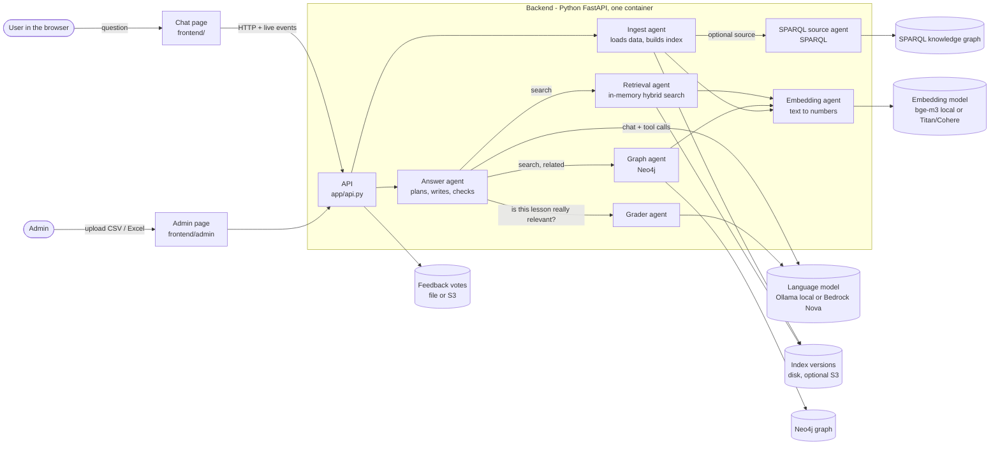
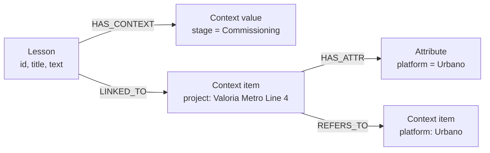

# Talk to Lessons Learned: project documentation

> A chatbot that lets engineers and managers **describe their situation in their own words** and get back
> the **lessons learned from earlier, comparable projects**, each with **why it is relevant** and a **link to
> the original entry**.

This folder explains **how the whole system works**, from the big picture down to every source file.
Read it top to bottom once; after that, use it as a map.

- New to the topic? Start with the [glossary](glossary.md): every technical word in two lines.
- Want to run it? See [Run it locally](#9-run-it-locally).
- Want the details of one file? Use the [file index](#11-file-index).

---

## 1. What problem it solves

Today, lessons learned live in a long list (a spreadsheet with columns like *Title*, *Process*, *Topic*,
*Project stage*, *Lesson*). Finding the right one means knowing the
right keywords and filters.

With this chatbot a user simply writes:

> *"We keep getting faults on site after software updates. Has this happened before and what did teams learn?"*

and gets something like this (an illustration of the chat card layout, not a captured run):

```
Summary: Earlier projects saw software changed on site without the regression suite...

[1003] Door software change again not regression tested        HIGH
       Learning: no software to site without a signed regression report.
       Why relevant: similar problem · stage: Commissioning · topic: Doors
       "deployed on site without the regression suite and caused a door fault"   (quote from the lesson)
       [original entry]  [👍] [👎]

[1001] Door controller firmware updated without regression test  MEDIUM
       ...
```

It covers 8 core capabilities (natural language, intent, semantic match, context, transferable learning, why relevant,
traceability, clarifying questions) and three main kinds of questions (project, component, problem).

---

## 2. The big picture



**In words:**

1. The **chat page** sends the question to the **API**.
2. The **answer agent** works like a careful researcher: it **searches** the lessons (meaning + keywords + context),
   lets a second model, the **grader**, check which found lessons really fit, then lets the language model write a
   short answer, and finally **checks every claim in code** (only real lessons, real quotes, real reasons).
3. The lessons come from an **index** built by the **ingest agent** from the spreadsheet(s). The index is a
   versioned folder on disk (and optionally in S3), so a new upload never breaks running answers.
4. **Neo4j** (a graph database) can hold the same data as a graph: lessons connected to projects, stages,
   suppliers. It answers "which lessons are related to this one?" and can also do the search.
5. **Feedback** (👍/👎) is stored and gently moves helpful lessons up for similar questions.

Every piece can be switched on or off with a flag in `backend/.env` (see [Settings](#7-settings-and-flags)).

---

## 3. The main flows

Each flow has its own page with a diagram and the files involved, step by step.

| Flow | What happens | Page |
|---|---|---|
| Ask a question | question → search → grade → write → check → answer on screen | [flows/ask-a-question.md](flows/ask-a-question.md) |
| Load data | spreadsheet → mapping → embeddings → new index version → Neo4j | [flows/load-data.md](flows/load-data.md) |
| Admin upload | admin uploads a file → columns profiled → roles chosen → ingest job | [flows/admin-upload.md](flows/admin-upload.md) |
| Feedback | 👍/👎 → stored → bad cached answer removed → ranking nudged | [flows/feedback.md](flows/feedback.md) |
| Agents | how the parts are separated and can run as separate services | [flows/agents.md](flows/agents.md) |
| Storage and versions | index folders, CURRENT pointer, S3 mirror | [flows/storage-and-versions.md](flows/storage-and-versions.md) |
| Deployment | Docker image, AWS Fargate, S3, Bedrock | [flows/deployment.md](flows/deployment.md) |

---

## 4. How a lesson is found and ranked (short version)

For each question every lesson gets a **score** from five parts
(details: [search/memory.py](files/backend/app/search/memory.md), [search/fusion.py](files/backend/app/search/fusion.md)):

```
score = text match            0..1   meaning (embeddings) + keywords (BM25), merged with RRF
      + context bonus          0.05 for each matching stage / topic / department ...
      + related-item bonus     0.15 x how close the lesson's project is to the project you named
      + data signals           e.g. impact rating 5/5 -> +0.05
      + feedback               up to +-0.1 from votes on similar questions
```

Then:

1. the top 8 go to the **grader** (relevant / partial / not), if there are any hits and the grader is on,
2. the language model writes the answer from the kept lessons,
3. **code checks** remove anything not backed by the data,
4. lessons are shown **in score order**, each with a **confidence** label (high / medium / low).

Example: lesson 1003 has impact 5 of 5, so its data-signal part is 5/5 × 0.05 = +0.05. If it is also the best text match
(1.0 after RRF rescaling), its score is 1.050. (Which lesson is the best text match depends on the embedding model;
this is an illustration, not a recorded run.)

---

## 5. Agents (the building blocks)

An **agent** here is simply a part of the backend with a small set of named methods. Today they all run in
one process; each can be moved to its own service by setting a URL, without changing other code
([flows/agents.md](flows/agents.md)).

| Agent | Job | File |
|---|---|---|
| Answer | plans the search, calls tools, writes and checks the answer | [agents/answer.py](files/backend/app/agents/answer.md) |
| Retrieval | in-memory hybrid search over the current index | [agents/retrieval.py](files/backend/app/agents/retrieval.md) |
| Graph | Neo4j: build the graph, search, related lessons | [agents/graph.py](files/backend/app/agents/graph.md) |
| Grader | grades found lessons: relevant / partial / not | [agents/grader.py](files/backend/app/agents/grader.md) |
| Embedding | turns text into vectors (numbers that capture meaning) | [agents/embedding.py](files/backend/app/agents/embedding.md) |
| Ingest | loads data and publishes a new index version | [agents/ingest.py](files/backend/app/agents/ingest.md) |
| SPARQL source | reads lessons from a knowledge graph over SPARQL | [agents/sparql_source.py](files/backend/app/agents/sparql_source.md) |

---

## 6. The data model (generic)

The system does **not** hard-code column names. A mapping file, [`config/dataset.yaml`](files/backend/config/dataset.yaml.md),
says which column is the id, the title, the text, which columns are **context** (stage, topic, department…),
which are **ranking signals** (impact, rating, date) and which to ignore (personal names).

Extra files such as `projects.csv`, `suppliers.csv`, `platforms.csv` are **context sources**: tables that
describe things a lesson links to. Their attributes decide which projects are **comparable**
(same platform, vehicle type, GoA level…). Any number of context sources can be added in the mapping.



(This is also the shape of the Neo4j graph: [agents/graph.py](files/backend/app/agents/graph.md).)

---

## 7. Settings and flags

All settings live in `backend/.env` (template: [`backend/.env.example`](files/backend/env.example.md);
code: [`app/settings.py`](files/backend/app/settings.md)). The most important ones:

| Setting | Default | What it does |
|---|---|---|
| `LLM_PROVIDER` / `LLM_MODEL_ID` | ollama / (set in .env) | which language model writes answers: e.g. `ollama` + `gemma4:12b` locally, or `bedrock` + `us.amazon.nova-2-lite-v1:0` for fast cloud answers |
| `EMBEDDING_PROVIDER` / `EMBEDDING_MODEL_ID` | ollama / bge-m3 | which model turns text into vectors |
| `SEARCH_STORE` | memory | `memory` (fastest) or `neo4j` |
| `FEATURE_NEO4J` | false | build and use the Neo4j graph |
| `FEATURE_EVIDENCE_GRADING` | false | turn the grader on (recommended with Bedrock) |
| `FEATURE_PARALLEL_GRADING` | true | grade and write at the same time (faster) |
| `FEATURE_ANSWER_CACHE` | true | repeat questions answered instantly |
| `FEATURE_SCORE_ORDER` | true | show lessons in search-score order |
| `FEATURE_FEEDBACK_BOOST` | true | votes nudge the ranking for similar questions |
| `FEATURE_UPLOAD_UI` / `ADMIN_TOKEN` | false | admin upload page |
| `DATA_SOURCE` | file | `file` (CSV / Excel from the mapping) or `sparql` |
| `STORAGE` | local | `local` disk or `s3` (for several containers) |

The full list, grouped and explained, is on the [settings page](files/backend/app/settings.md).

---

## 8. Quality: how answers stay trustworthy

- **Safety in code**: the model cannot invent a lesson, a quote or a reason; the code removes anything the data
  does not support (grounding checks in [answer.py](files/backend/app/agents/answer.md)).
- **Evidence grader**: a second, strict model call checks every found lesson before it is shown.
- **Measured speed and quality** (Nova 2 Lite + grader): about **3.0 s** per new question, repeated
  questions instantly from the cache.

---

## 9. Run it locally

To run it:

```bash
cd backend
cp .env.example .env                       # then choose models / flags
python3 -m venv .venv && .venv/bin/pip install -r requirements.txt
.venv/bin/python -m app.cli ingest         # build the index from the CSV files
.venv/bin/uvicorn app.api:create_app --factory --port 8000
# open http://localhost:8000          (chat)
# open http://localhost:8000/admin    (upload, if FEATURE_UPLOAD_UI=true)
```

Optional: `docker compose --env-file .env up -d neo4j` (from `backend/`) for the graph (browser at http://localhost:7474).

---

## 10. What to improve next

The honest list of limits and ideas, ranked, is on [improvements.md](improvements.md)
(fast path, lesson cards, MCP tool, Fargate rehearsal, real-data test set, ...).

---

## 11. File index

Every source file has its own page: what it is for, how it works, settings, who uses it, an example, tests,
and ideas to improve.

**Backend: entry points**
- [app/api.py](files/backend/app/api.md): web API and pages
- [app/cli.py](files/backend/app/cli.md): command line (ingest, search, ask, eval, bench, serve)
- [app/settings.py](files/backend/app/settings.md): all settings and flags

**Backend: agents** (`app/agents/`)
- [\_\_init\_\_.py](files/backend/app/agents/__init__.md): wiring (in-process or over HTTP)
- [answer.py](files/backend/app/agents/answer.md): the answer agent
- [retrieval.py](files/backend/app/agents/retrieval.md): in-memory search agent
- [graph.py](files/backend/app/agents/graph.md): Neo4j agent
- [grader.py](files/backend/app/agents/grader.md): evidence grader
- [embedding.py](files/backend/app/agents/embedding.md): embedding agent
- [ingest.py](files/backend/app/agents/ingest.md): ingest agent
- [sparql_source.py](files/backend/app/agents/sparql_source.md): SPARQL source agent
- [transport.py](files/backend/app/agents/transport.md): local / HTTP calls between agents
- [clients.py](files/backend/app/agents/clients.md): embedding proxy

**Backend: search and data**
- [dataset.py](files/backend/app/dataset.md): reading CSV / Excel with the mapping
- [context.py](files/backend/app/context.md): matching the user's words to context values
- [context_sources.py](files/backend/app/context_sources.md): projects, suppliers…, comparable items
- [ranking.py](files/backend/app/ranking.md): data signals (impact, rating, recency)
- [search/fusion.py](files/backend/app/search/fusion.md): merging meaning + keyword results
- [search/memory.py](files/backend/app/search/memory.md): the in-memory index and score
- [index_files.py](files/backend/app/index_files.md): index versions, S3 mirror
- [feedback.py](files/backend/app/feedback.md): votes and the feedback boost
- [cache.py](files/backend/app/cache.md): answer cache
- [upload.py](files/backend/app/upload.md): admin upload: profiling and mapping
- [sparql.py](files/backend/app/sparql.md): SPARQL client for SPARQL source

**Backend: models**
- [llm.py](files/backend/app/llm.md): Ollama and Bedrock chat models
- [embeddings.py](files/backend/app/embeddings.md): embedding models and the cache
- [assistant.py](files/backend/app/assistant.md): wording and word lists
- [evaluation.py](files/backend/app/evaluation.md): scoring answers against your own question set (`EVAL_QUESTIONS`)

**Config**
- [config/dataset.yaml](files/backend/config/dataset.yaml.md): the data mapping
- [config/dataset.sparql.yaml](files/backend/config/dataset.sparql.yaml.md): mapping for SPARQL source
- [config/assistant.yaml](files/backend/config/assistant.yaml.md): texts and examples
- [.env.example](files/backend/env.example.md): all settings with comments

**Frontend**
- [index.html](files/frontend/index.html.md) · [app.js](files/frontend/app.js.md) · [style.css](files/frontend/style.css.md): chat page
- [admin.html](files/frontend/admin.html.md) · [admin.js](files/frontend/admin.js.md) · [admin.css](files/frontend/admin.css.md): admin page

**Tooling**
- [Dockerfile](files/Dockerfile.md) · [docker-compose.yml](files/backend/docker-compose.yml.md) ·
  [requirements](files/backend/requirements.md) · [.gitignore / .dockerignore](files/ignore-files.md)
