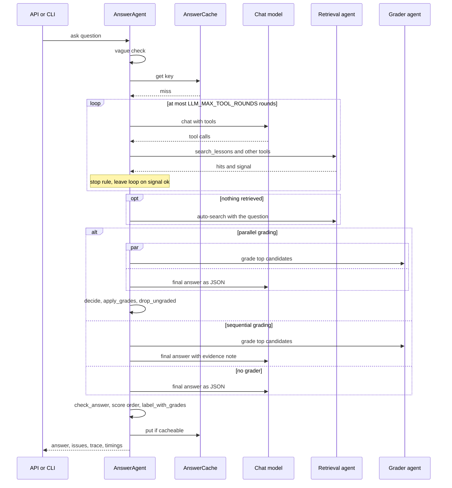

# `backend/app/agents/answer.py`

> The answer agent: it takes one user question, lets the chat model search the lessons, checks what the model wrote against the data, and returns an answer where every cited lesson is real.

**Part of:** [Ask a question](../../../../flows/ask-a-question.md) · [Agents](../../../../flows/agents.md) · [Feedback](../../../../flows/feedback.md) (cache eviction)  ·  **Layer:** Agent

## Purpose

A chat model on its own can invent lessons, IDs or quotes. This file wraps the model in a fixed procedure: the model may only use lessons that the search tools returned, and code (not the model) decides what is finally shown, how confident it is and why it is relevant.

Example: a user asks "Door software keeps failing on site". The model calls `search_lessons`, gets lesson 1003 "Door software change again not regression tested" and lesson 1001 "Door controller firmware updated without regression test", and writes an answer. The code then checks that 1003 and 1001 were really found, that each quote is copied from the lesson text, and builds the "why relevant" reasons (for example "stage: Commissioning") from the search results.

All terms like [tool call](../../../../glossary.md), [grounding](../../../../glossary.md), [evidence grader](../../../../glossary.md) and [answer cache](../../../../glossary.md) are explained in the [glossary](../../../../glossary.md).

## How it works

`AnswerAgent.ask(question, history, on_event)` runs these steps in order:

1. **Vague check.** If `FEATURE_CLARIFYING_QUESTIONS` is on, there is no earlier conversation, and the question contains only filler words (from `config/assistant.yaml`, e.g. "hi, tell me about lessons"), the agent returns the fixed `clarify_question` text at once. No model call, no search, no cache. This is decided in code so it does not depend on how a given model behaves. A word counts as real only if it is not a filler word and has more than 2 letters.
2. **Cache lookup.** If `FEATURE_ANSWER_CACHE` is on, the agent builds a cache key (see `_cache_key` below). On a hit it sends a `cached` event and returns the stored result with `cached: True`. The key does not include feedback votes, so a cached answer can lag new votes by up to the TTL (time to live).
3. **Build the prompts.** `_answer` asks the retrieval agent for the context `sources` and `dimensions` (read per question, because an upload can add new ones) and fills the `SYSTEM` prompt with the wording from `assistant.yaml`. It also prepares the `FINAL` prompt that asks for JSON.
4. **Tool loop.** At most `LLM_MAX_TOOL_ROUNDS` rounds (default 2): call the model with the tools. If the reply has no tool calls, stop. Otherwise run every tool call (`_run_tool`), add the results to the message list, and stream a `tool` event (and a `candidates` event with up to 5 titles after each search, so the UI can show what was found before the answer is written).
   - **Stop rule** (`FEATURE_STOP_RULE`): if any `search_lessons` in this round came back with signal `"ok"`, leave the loop right away instead of asking the model what to do next. This saves one model call.
5. **Auto-search.** If after the loop nothing was retrieved (the model never searched), the code runs `search_lessons` with the raw question itself. The answer is then still based on real lessons. The trace marks it `auto: True`.
6. **Pick the grader input.** The top `GRADER_MAX_CANDIDATES` (default 8) hits by rank, and a grader question built by `grader_question` (the question plus up to 2 earlier user messages and the search queries used). If the search found nothing, the grader is skipped (`grader = self.grader if top else None`): "no hits" is a normal "nothing found" answer, not a grader failure.
7. **Final answer, in one of three ways** (see the diagram):
   - **No grader** (`FEATURE_EVIDENCE_GRADING` off, or no hits): one final model call with the JSON schema.
   - **Sequential grading** (`FEATURE_PARALLEL_GRADING=false`): grade first. If every lesson is graded "not", abstain (no final model call). Otherwise remove the lessons the grader did not keep and put an "Evidence check: ..." note in front of the final prompt, so the model cites only the kept lessons. Then make the final call.
   - **Parallel grading** (default when the grader is on): start the grader in a background thread and make the final model call at the same time. When both are done, apply the grades in code. If the grader says "none fit", abstain (the final answer is thrown away).
   - In every case the final call goes through `_final`. If the call raises (timeout, cut-off reply) or returns no usable JSON, it is not an error for the user: an issue is added ("final answer failed (...)" or "final answer had no usable content") and the answer is built from the data instead: cards from the lessons the grader kept (or the top 3 hits without a grader), with `filtered_summary_text` from `assistant.yaml` as the summary.
8. **Clean up the answer** (parallel grading only): `drop_ungraded` removes lessons the model cited but the grader did not keep. If that leaves nothing, `cards_from_data` builds up to 3 cards directly from the lessons the grader kept.
9. **Grounding checks** (`FEATURE_GROUNDING_CHECKS`): `check_answer` keeps only lessons that were really retrieved, removes quotes that are too short or not in the text, and builds or checks the "why relevant" reasons. With the checks off, `attach_lessons` still drops unknown IDs.
10. **Score order** (`FEATURE_SCORE_ORDER`): sort the lessons by the search's rank (then score), not by the model's order.
11. **Labels from the grades:** `label_with_grades` marks partial fits, adds what is missing, and for "related only" answers sets every confidence to "low" and may replace the summary with a fixed text.
12. **Result:** `{answer, issues, trace, timings, degraded, not_found}`, plus an `id` (12 hex characters) added in `ask`. The result goes into the cache only if `cacheable` says so.



### How the grades are used

- `decide(top, result)` turns the grader's verdict into a plan. A lesson the grader skipped counts as "partial".
  - At least one "relevant": mode `answer`. Keep all relevant ones, plus partial ones only to fill up to 3 in total.
  - No relevant but some partial: mode `related_only`. Keep up to 3 partial ones.
  - All "not": mode `none`. The agent abstains.
- `apply_grades(retrieved, graded)` writes the grade onto each kept hit and **deletes** every other hit from `retrieved`. Since all later checks only accept lessons in `retrieved`, the removed ones can never be shown.
- Lessons ranked below the top `GRADER_MAX_CANDIDATES` were not graded, so they are also removed, and an issue says how many.
- In sequential mode `evidence_note` tells the model which lesson IDs are left; in parallel mode the model wrote without that note, so `drop_ungraded` cleans up afterwards.
- `_abstain` returns the `no_match_text` from `assistant.yaml`, plus "Not covered: ..." and the grader's `next_step` suggestion. No lessons, `not_found: True`.

### Grounding checks in `check_answer`

For each lesson the model cited:
- The ID must be in `retrieved`, otherwise it is dropped ("dropped 1009: not in retrieved lessons").
- The quote must be at least 15 characters (`MIN_QUOTE_CHARS`) after trimming and must appear in the lesson title plus text (both lowercased, spaces squashed). Otherwise the quote is removed, but the lesson stays.
- **Reasons from code** (`FEATURE_REASONS_IN_CODE`, default on): the model only writes `problem_match`. `code_reasons` builds the reasons from what the search found: `context_match` (dimension and value), `same_item` / `comparable_item` (source and name), `feedback` ("2 up, 0 down"). It adds `similar_problem` only if the model gave a `problem_match` **and** a valid quote survived.
- **Reasons from the model** (flag off): each reason is checked. `context_match` must match the lesson's context, `same_item` / `comparable_item` must be one the search produced, `similar_problem` needs a valid quote. Anything else is removed with an issue.
- A clarifying question of "none", "null", "n/a" or "no" is treated as empty.
- If the model cited lessons but all were dropped and there is no clarifying question, the summary is replaced with `NOT_SUPPORTED`, because the model's summary describes lessons that are no longer shown.

### Confidence and search signal

Both come from retrieval numbers and the grader, never from the answer model's opinion of itself. "Evidence" means reasons other than feedback votes (votes help ranking but do not prove relevance).

- `confidence(hit)`:
  - `low` if the similarity is below `CONFIDENCE_MIN_SIMILARITY` (0.45).
  - `high` if the hit is in the top 3, its similarity is at least 90% of the best hit's, it has evidence reasons or grade "relevant", and its grade is not "partial".
  - `low` if its similarity is below 75% of the best hit's, it has no evidence reasons and is not graded "relevant".
  - `medium` otherwise.
- `search_signal(hits)`, sent to the model with each search:
  - `none` if there are no hits.
  - `weak` if the best similarity is below the floor and no hit has evidence reasons.
  - `weak` if there are 5 or more hits, the 1st and 5th similarity differ by less than 0.02 (a flat list, nothing stands out) and no hit has evidence reasons.
  - `ok` otherwise. This is what the stop rule looks at.

### The degraded flag

`degraded` is true when any of these happened:
- the grader was used (there were hits) but gave no usable verdict;
- the final model reply failed or had no usable content (see `_final`);
- any tool call returned an error.

A degraded answer is shown as is but never cached (`cacheable`), so the next ask tries again.

## Key components

- `TOOLS`, `RELATED_TOOL`: the tool descriptions the model sees: `search_lessons`, `resolve_context`, `comparable_items`, `count_by`, and `related_lessons` only when a graph client exists.
- `ANSWER_SCHEMA` / `COMPACT_SCHEMA`: the JSON shape of the final answer. Compact is used with reasons from code (the model writes `problem_match` instead of a reason list).
- `SYSTEM`, `FINAL`, `CLARIFY_*`, `MODEL_REASONS`, `CODE_REASONS`: prompt text. Domain wording comes from `assistant.yaml`.
- `is_vague(question, filler)`: True if no word is longer than 2 letters and outside the filler list.
- `clean_args(name, args)`: keeps only known tool arguments of the right type (numbers become strings, `context` is normalised, empty values dropped). Returns `(args, error)`; error if the tool is unknown or the required argument is missing.
- `AnswerAgent(settings, llm, retrieval_client, graph_client, grader_client)`: the agent. Exposes `ask` and `forget`.
- `AnswerAgent.ask(question, history, on_event)`: the full flow above. `on_event` only works in-process; the API uses it to stream progress.
- `AnswerAgent.forget(answer_id)`: called on a thumbs-down; removes that answer from the cache. Returns `{"forgotten": bool}`.
- `_cache_key(question, history)`: hash of the normalised question, the history, the index version (from the retrieval agent), all settings starting with `feature_`, `llm_`, `grader_`, `top_k`, `score_w`, `tool_text`, `confidence_`, and the hash of `assistant.yaml`.
- `_run_tool(name, args, retrieved)`: cleans the arguments and calls the retrieval or graph agent. For a search it stores the full hits in `retrieved` and sends the model a trimmed version (`for_model`). Errors are returned to the model as `{"error": ...}` instead of failing the answer.
- `_final(timings, system, messages, schema, issues)`: the final model call. Catches any exception or empty reply, adds an issue and returns an empty `Reply`, so the caller falls back to cards built from the data.
- `_call_grader(...)`: calls the grader; on an exception, or when fewer than half the candidates got a real grade, it adds an issue and returns None (answer goes on without grades).
- `remember_hits(retrieved, hits)`: merges hits from several searches. A better rank in a later search updates rank, score and similarity; reasons are added.
- `for_model(result, signal, text_chars)`: what the model reads from a search: signal, context used, unresolved words, and hits with text cut to `TOOL_TEXT_CHARS`, no scores.
- `check_answer(answer, retrieved, min_similarity, reasons_from_code)`: the grounding checks. Returns `(answer, issues)`.
- `code_reasons(hit, problem_match, quote)`: reasons built from the search.
- `confidence(hit, min_similarity)` and `search_signal(hits, min_similarity)`: see above.
- `decide`, `apply_grades`, `drop_ungraded`, `cards_from_data`, `label_with_grades`, `evidence_note`, `abstain_answer`: see "How the grades are used".
- `cards_from_data(retrieved, ids)`: cards without the model: the start of the lesson text (up to 200 characters, via `dataset.short_title`) as the learning, empty quote and reasons (reasons are filled later by `check_answer` when reasons come from code).
- `label_with_grades(...)`: sets `fit: "partial"`, `missing`, `related_only`, low confidence, and with `summary_from_code` uses `related_only_text` or `filtered_summary_text` from `assistant.yaml` as the summary.
- `cacheable(result)`: True only if not degraded and the answer is not empty.

## Configuration

| Setting | Default | Effect here |
|---|---|---|
| `FEATURE_CLARIFYING_QUESTIONS` | true | Vague first questions get a fixed clarifying question; the prompts allow one follow-up question. Off: `clarifying_question` is always empty. |
| `FEATURE_ANSWER_CACHE` | true | Turns the answer cache on. |
| `ANSWER_CACHE_TTL_SECONDS` | 900 | How long a cached answer lives. |
| `ANSWER_CACHE_SIZE` | 500 | Max cached answers per process. |
| `LLM_MAX_TOOL_ROUNDS` | 2 | At most this many model calls with tools; then the final answer call. |
| `FEATURE_STOP_RULE` | true | A search with signal "ok" ends the tool loop. |
| `FEATURE_AUTO_RESOLVE_CONTEXT` | true | Prompt tells the model search maps loose context words itself; off: model is told to use `resolve_context`. |
| `FEATURE_REASONS_IN_CODE` | true | Reasons built from search results, compact schema; off: model writes reasons, code checks them. |
| `TOOL_TEXT_CHARS` | 600 | Lesson text characters sent to the model per hit. |
| `CONFIDENCE_MIN_SIMILARITY` | 0.45 | Similarity floor for confidence and search signal. |
| `FEATURE_EVIDENCE_GRADING` | false | Whether a grader client is passed in (decided in [`__init__.py`](__init__.md)). |
| `GRADER_MAX_CANDIDATES` | 8 | How many top hits are graded; the rest are left out. |
| `FEATURE_PARALLEL_GRADING` | true | Grade and write at the same time; off: grade first, then write. |
| `FEATURE_GROUNDING_CHECKS` | true | Run `check_answer`; off: only unknown IDs are dropped. |
| `FEATURE_SCORE_ORDER` | true | Show lessons in search order, not the model's order. |
| `FEATURE_NEO4J` | false | With a graph client the `related_lessons` tool is offered. |
| `ASSISTANT_CONFIG` | `./config/assistant.yaml` | Prompt intro, situation words, filler words and fixed texts. |

## Dependencies

- **Used by:** [`__init__.py`](__init__.md) (`make_answer_agent`), which is called by [`api.py`](../api.md), [`cli.py`](../cli.md) and [`evaluation.py`](../evaluation.md).
- **Uses:** the chat model from [`llm.py`](../llm.md); the retrieval agent ([`retrieval.py`](retrieval.md), or [`graph.py`](graph.md) with `SEARCH_STORE=neo4j`) through a client from [`transport.py`](transport.md); the [graph agent](graph.md) for `related_lessons`; the [grader](grader.md); [`cache.py`](../cache.md); [`assistant.py`](../assistant.md); [`context.py`](../context.md) (normalise and match context); [`dataset.py`](../dataset.md) (`short_title`).

## Example

Question: "Door software keeps failing on site" (no history, grader on, parallel).

1. The model calls `search_lessons({"query": "door software failing on site"})`. Search returns 1003, 1001, ... with signal `ok`, so the stop rule ends the loop.
2. Grader and final answer run together. Grader: 1003 relevant, 1001 relevant, 1002 not.
3. The model's answer cited 1003, 1001 and 1002. `drop_ungraded` removes 1002 ("1002: left out by the evidence check") and, because something was dropped, the summary becomes the fixed `filtered_summary_text`.
4. `check_answer` keeps the quote "deployed on site without the regression suite" (found in the text of 1003) and builds reasons such as `context_match stage = Commissioning` and `similar_problem`.
5. Result (shortened):

```json
{"answer": {"summary": "These lessons from earlier projects fit your situation best.",
  "lessons": [{"id": "1003", "title": "Door software change again not regression tested",
               "quote": "deployed on site without the regression suite", "confidence": "high",
               "why_relevant": [{"type": "similar_problem", "value": "software change caused door fault on site"}]}]},
 "issues": ["1002: left out by the evidence check"], "degraded": false, "not_found": false}
```

The exact reasons and confidence depend on the search scores; this is an illustration.

## Known limitations and improvements

- **Parallel grading can waste the final call:** if the grader says nothing fits, the final answer that was written at the same time is thrown away (cost, not correctness).
- **Any tool error marks the answer degraded**, including a model passing a bad argument (e.g. missing `query`). Such answers are never cached.
- **The cache ignores feedback votes** (documented in the code): a cached answer can lag new votes by up to `ANSWER_CACHE_TTL_SECONDS`. A thumbs-down evicts only the answer it was given on.
- **Vague-question replies** get an `id`, a `timings` entry ("vague check") and `degraded: false` like other answers; they are never cached (no model call to save).
- A named project / supplier that the search could not resolve reaches the model as `related_not_found` (`{source: candidate names}`): several names → the model can ask which one; empty → no such item.
- Three retrieval calls per question just for setup (`version`, `sources`, `dimensions`); idea: one combined `info` call.
- Ideas: a search-first fast path with one small-model selection call, and a shared cache (DynamoDB) instead of one per container.
