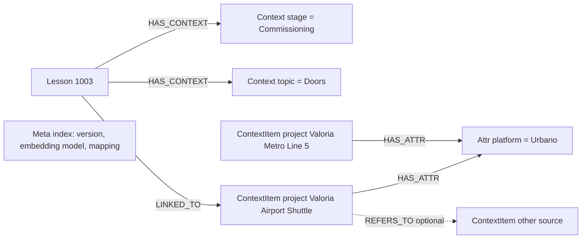
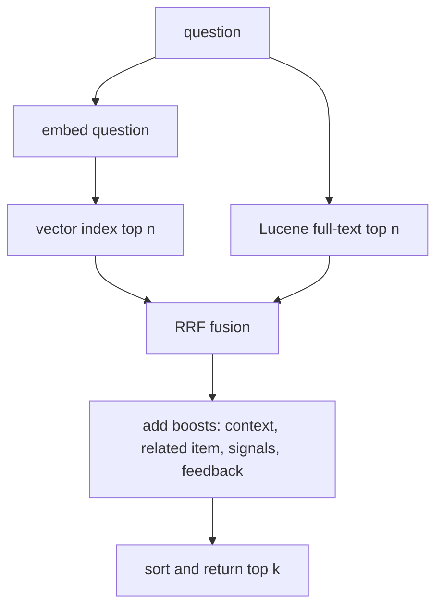

# `backend/app/agents/graph.py`

> The Neo4j graph agent: it copies the current index into a Neo4j graph, searches it, and answers graph questions such as "which lessons are related to lesson 1001?".

**Part of:** [Load data](../../../../flows/load-data.md) · [Ask a question](../../../../flows/ask-a-question.md) · [Agents](../../../../flows/agents.md) · [Feedback](../../../../flows/feedback.md)  ·  **Layer:** Agent

## Purpose
The project is about a lessons-learned graph, and some questions are about connections: "what else happened on the same project?", "which lessons share rare context with this one?". A graph database answers these by following links. This agent keeps a Neo4j copy of the index (a *mirror*: it is always rebuilt from the index, never edited by hand) and offers:
- the same search calls as the [retrieval agent](retrieval.md), so `SEARCH_STORE=neo4j` can serve all search from Neo4j;
- `related_lessons`, which only the graph offers (the chat gets this tool when `FEATURE_NEO4J=true`).

Neo4j, Cypher (its query language), Lucene (its keyword search engine) and vector index are explained in the [glossary](../../../../glossary.md).

## How it works

### Graph model
Everything is generic: a new column or a new context source becomes new nodes, not a schema change.



- `(:Lesson {id, title, text, signals_json, embedding, search_text})`: one node per lesson.
- `(:Context {dimension, value})`: a plain context value, for example stage = Commissioning. Shared by all lessons that have it.
- `(:ContextItem {source, id, name, attrs_json})`: one row of a context source, for example a project. A lesson value that names a known item becomes a `LINKED_TO` link; an unknown name stays a plain `Context` node.
- `(:Attr {source, name, value})`: one compare attribute of an item, for example platform = Urbano. Two projects with the same platform point to the same `Attr` node. Negative values ("false", "no", "0", "n") are not stored.
- `REFERS_TO {column}`: optional link between items, from `references` in the mapping (for example project to platform).
- `(:Meta {key: 'index'})`: the index version, embedding model and mapping the graph was built from.

### Build
1. Read the current index version (lessons, context items, vectors, mapping) from the [index store](../index_files.md).
2. Prepare rows for items, attributes, references and lessons. The lesson `search_text` is the same text the memory store searches (`Lesson.embed_text()`).
3. Create two uniqueness constraints (lesson id; item source + id).
4. In **one transaction**: delete all old nodes of these labels, then load everything in chunks of 500 rows. If anything fails, the old graph stays.
5. Create or keep the vector index `lesson_embedding` (cosine) and the full-text index `lesson_text` (Lucene, analyzer from `NEO4J_FULLTEXT_ANALYZER`). An index is dropped and rebuilt only when its dimension or analyzer changed.

### Search

1. Clean and align the context like the retrieval agent does.
2. Check that the graph was built with the same embedding model as the current embedder; otherwise raise an error.
3. Ask the vector index for the top `TOP_K_CANDIDATES` lessons and the full-text index for the top `TOP_K_CANDIDATES` (the question is lowercased and escaped first, see `lucene_escape`).
4. Fuse the two lists with RRF (see [fusion.py](../search/fusion.md)).
5. For each candidate, read its context and cosine similarity from Neo4j, then add the same boosts as the memory store: `SCORE_W_CONTEXT` x context matches, `SCORE_W_RELATED` x related-item score, ranking signals, `SCORE_W_FEEDBACK` x feedback score.
6. Sort by score and return the top `k`, in the same shape as the memory store.

### related_lessons scoring
For one lesson, three kinds of links to other lessons are scored and summed per other lesson:

| Link | Weight | Why |
|---|---|---|
| Shares a plain context value | 3.0 / (number of lessons with that value) | A rare shared value says more than a common one |
| Linked to the same context item | 2.0 | Same project |
| Linked to a *comparable* item (shares `Attr` nodes) | shared attrs / attrs of this lesson's item, at most 1.0 | Never outweighs the same item |

The top 4 reasons are kept per related lesson, and the result is the top `limit` by total weight.

Worked example (computed by hand from the made-up data, not from a live Neo4j run): lesson 1001 "Door controller firmware updated without regression test" vs lesson 1003 "Door software change again not regression tested".
- shared process "Software release": 3 lessons have it, 3 / 3 = 1.0
- shared topic "Doors": 5 lessons, 3 / 5 = 0.6
- shared department "Quality": 6 lessons, 3 / 6 = 0.5
- shared product group "Metro": 11 lessons, 3 / 11 = 0.27
- shared location "Aldmoor-North": 11 lessons, 3 / 11 = 0.27
- comparable project: 1001 is on Valoria Metro Line 4, 1003 on Valoria Airport Shuttle; they share 5 of Line 4's 8 stored attributes, 5 / 8 = 0.63
- total about 3.27

## Key components
- `GraphAgent(settings, embedding_client, driver=None)`: connects to Neo4j (`NEO4J_URI`, user, password, database). A test can pass its own driver.
- `build()`: rebuilds the graph from the current index; returns version and `stats()`.
- `stats()`: counts of lessons, context items, contexts, attrs, relationships, and the version.
- `search(query, context=None, related_to=None, k=None)`: hybrid search as above; same output shape as the [retrieval agent](retrieval.md).
- `get_lesson(id)`: one lesson with its context rebuilt from the graph.
- `related_lessons(id, limit=5)`: `{"id", "related": [{id, title, weight, why}]}`.
- `comparable_items`, `count_by`, `dimensions`, `resolve_context`, `sources`, `version`: same meaning as in the retrieval agent, read from the graph.
- `_lesson_context(plain, linked, sources)`: turns graph rows back into `{dimension: [values]}`, putting linked items under their source's lesson column.
- `lucene_escape(text)`: lowercases (so AND / OR / NOT are not operators) and escapes Lucene special characters.

## Configuration
| Setting | Default | Effect |
|---|---|---|
| `FEATURE_NEO4J` | false | Turns the graph agent on; ingest then rebuilds the graph |
| `SEARCH_STORE` | memory | `neo4j` makes this agent answer all retrieval calls |
| `NEO4J_URI`, `NEO4J_USER`, `NEO4J_PASSWORD` | none | Connection |
| `NEO4J_DATABASE` | neo4j | Database name |
| `NEO4J_FULLTEXT_ANALYZER` | english | Lucene analyzer for the full-text index |
| `AGENT_GRAPH_URL` | empty | Call the agent over HTTP instead of in-process |
| `TOP_K_CANDIDATES`, `TOP_K_ANSWER` | 20, 8 | Candidates per index, hits returned |
| `FEATURE_VECTOR_SEARCH`, `FEATURE_KEYWORD_SEARCH` | true, true | Which indexes are queried |
| `FEATURE_CONTEXT_BOOST`, `SCORE_W_CONTEXT` | true, 0.05 | Context match boost |
| `SCORE_W_RELATED` | 0.15 | Same / comparable item boost |
| `FEATURE_AUTO_RESOLVE_CONTEXT` | true | Map loose context values |
| `FEATURE_FEEDBACK_BOOST`, `SCORE_W_FEEDBACK` | true, 0.1 | Feedback boost |

Ranking signal weights come from `ranking:` in the mapping (see [ranking.py](../ranking.md)).

## Dependencies
- **Used by:** [agents/\_\_init\_\_.py](__init__.md) (`graph_client`, `retrieval_client` when `SEARCH_STORE=neo4j`, `make_agent`); the [ingest agent](ingest.md) calls `build`; the [answer agent](answer.md) calls `related_lessons`; the [CLI](../cli.md) has `graph build|stats|related`; the [API](../api.md) serves `/api/lessons/{id}/related`.
- **Uses:** [index_files.py](../index_files.md), [context.py](../context.md), [context_sources.py](../context_sources.md), [ranking.py](../ranking.md), [feedback.py](../feedback.md), [search/fusion.py](../search/fusion.md), [dataset.py](../dataset.md), [agents/clients.py](clients.md), the `neo4j` Python driver.

## Example
```python
graph.call("related_lessons", id="1001", limit=3)
```
Shape of the answer (values illustrative, see the worked example above):
```json
{"id": "1001", "related": [
  {"id": "1025", "title": "Door software regression suite incomplete", "weight": 4.02,
   "why": ["shared process: Software release", "comparable project: Valoria Metro Line 5",
           "shared topic: Doors", "shared department: Quality"]}]}
```

## Known limitations and improvements
- Graph search only scores the top `TOP_K_CANDIDATES` from each index; the memory store scores every lesson. A boost cannot lift a lesson that neither index returned.
- Comparable items differ from the memory store: the graph does not store negative values and `related_lessons` counts shared attributes without weights, while [context_sources.similarity](../context_sources.md) uses the `compare` weights and counts a "true" vs "false" pair as a mismatch. Known: Line 4 vs Line 5 = 1.00 in the graph vs 0.93 in memory.
- When no candidate is found, `search` returns early with the same keys as the normal case (`related_to`, `unknown`, `related_candidates`, `context_used`, `context_mapped`, `context_unresolved`, `hits: []`); named items are still resolved.
- `count_by` returns no `over` count, unlike the retrieval agent.
- `count_by` on a context-source column returns item names even when `match_on: id`, while `dimensions()` returns ids in that case.
- The whole graph is deleted and reloaded in one transaction. Fine for thousands of lessons; idea: incremental updates for larger data.
- Idea: let the graph's Lucene index use stemming per language (already configurable through the analyzer), and compare its recall with the memory BM25 in the eval.
