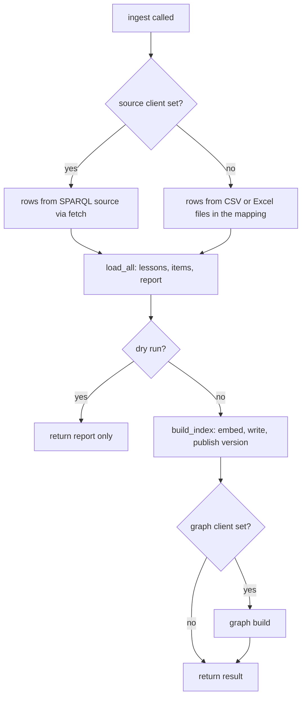

# `backend/app/agents/ingest.py`

> The ingest agent: it loads lessons and context rows, builds a new index version, publishes it, and asks the graph agent to rebuild Neo4j.

**Part of:** [Load data](../../../../flows/load-data.md) · [Admin upload](../../../../flows/admin-upload.md) · [Storage and versions](../../../../flows/storage-and-versions.md) · [Agents](../../../../flows/agents.md)  ·  **Layer:** Agent

## Purpose
Before anyone can ask a question, the lessons must be read, checked, turned into embeddings (number lists that capture meaning, see the [glossary](../../../../glossary.md)) and saved as an index. This agent is the one entry point for that, used by the CLI (`python -m app.cli ingest`) and by the admin upload page. For example, after an upload with a new "Supplier" column, it produces a new index version in which `supplier` is a searchable dimension.

## How it works

1. Use the `mapping` passed in (from the upload page) or load the configured one.
2. If a SPARQL source client is set, rows come from its `fetch` call; otherwise from the files in the mapping.
3. [`load_all`](../dataset.md) returns lessons, context items and a load report (rows, loaded, skipped with reasons, unknown links).
4. With `dry_run=True` it stops here and returns the report.
5. Otherwise [`build_index`](../search/memory.md) embeds the lessons, writes a new version folder and publishes it (the `CURRENT` pointer moves).
6. If a graph client is set, it calls `build`. If that fails, the new index stays live and the result says the graph still shows the previous index.

## Key components
- `IngestAgent(settings, embedding_client, graph_client=None, source_client=None)`: wiring; the clients are optional.
- `ingest(dry_run=False, mapping=None)`: returns `{rows, loaded, skipped, unknown_links, context_items, version, graph, source}`.

## Configuration
| Setting | Default | Effect |
|---|---|---|
| `DATASET_CONFIG` | `config/dataset.yaml` | Mapping used when none is passed |
| `DATA_SOURCE` | file | Reported in the result; `sparql` makes the wiring add a source client |
| `FEATURE_NEO4J` | false | When true the wiring adds a graph client, so ingest rebuilds Neo4j |
| `STORAGE` | local | Where the new version is written and published (see [index_files.py](../index_files.md)) |

## Dependencies
- **Used by:** [agents/\_\_init\_\_.py](__init__.md) (`make_ingest_agent`), called from the [CLI](../cli.md) and the admin endpoints in [api.py](../api.md).
- **Uses:** [dataset.py](../dataset.md), [search/memory.py](../search/memory.md) (`build_index`), [index_files.py](../index_files.md), [agents/clients.py](clients.md), and over its clients the [graph agent](graph.md) and the [SPARQL source agent](sparql_source.md).

## Example
`python -m app.cli ingest --dry-run` on the made-up data gives (shortened):
```json
{"rows": 30, "loaded": 27,
 "skipped": [{"id": "1026", "reason": "filtered out by Status"},
             {"id": "1027", "reason": "empty lesson text"},
             {"id": "1030", "reason": "filtered out by Status"}],
 "unknown_links": {}, "context_items": {"project": 10},
 "version": null, "graph": null, "source": "file"}
```
Without `--dry-run`, `version` is a new name like `20261118-101500-a1b2`.

## Known limitations and improvements
- With `DATA_SOURCE=sparql`, rows always come from the SPARQL source, even if a mapping is passed. This file does not guard that case; [api.py](../api.md) does: the admin upload routes return 409 "uploads are off while DATA_SOURCE=sparql".
- Embedding all lessons runs inside the call. Ideas: an SQS-driven worker and an eval gate before the pointer flips (not built).
- Idea from the roadmap: lesson enrichment (component, failure mode tags) as an extra step here; parked as a future plan.
