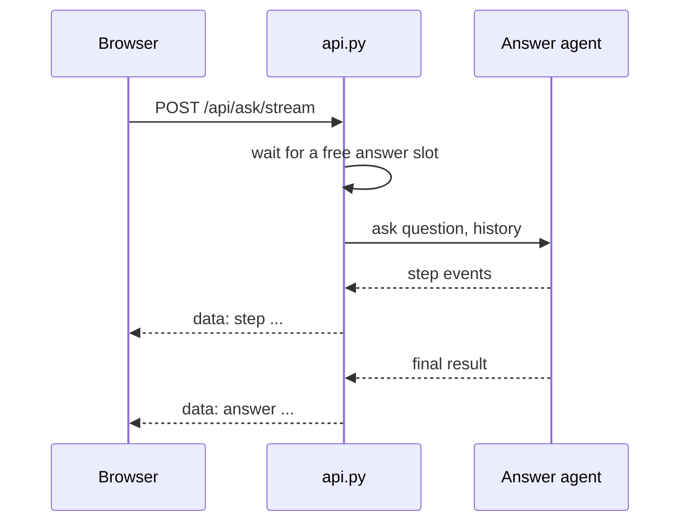

# `backend/app/api.py`

> The web server: every URL the chat page and the admin page call, plus the pages themselves.

**Part of:** [Ask a question](../../../flows/ask-a-question.md) · [Feedback](../../../flows/feedback.md) · [Admin upload](../../../flows/admin-upload.md) · [Agents](../../../flows/agents.md) · [Deployment](../../../flows/deployment.md)  ·  **Layer:** API

## Purpose
The browser cannot talk to the search index or the model directly. This file is the one door between them. It is a [FastAPI](../../../glossary.md) app: a Python library that turns functions into web addresses (routes). For example, when a user types "We keep getting faults on site after software updates", the chat page sends it to `POST /api/ask/stream`, and this file hands it to the answer agent and streams the result back.

## How it works
1. `create_app()` reads the settings and builds the pieces once: the embedding, retrieval and graph clients (see [agents/__init__](agents/__init__.md)), the wording from `assistant.yaml`, the index store and the feedback store.
2. The answer agent and the ingest agent are built lazily, on first use. So the server starts even if the model is not reachable yet.
3. Answers are limited by a counter of free slots (`MAX_CONCURRENT_ANSWERS`). A question waits up to `BUSY_WAIT_SECONDS` for a slot. If none frees up, the user gets "Too many questions at once" (HTTP 503).
4. Streaming answers run in a background thread. Each step (tool call, candidates, final answer) is put in a queue and sent as a [server-sent event](../../../glossary.md) (SSE: a one-way stream of small text messages over one HTTP response). Every 15 seconds without news a `: ping` line is sent so proxies do not cut the connection.
5. Admin routes check the `X-Admin-Token` header against `ADMIN_TOKEN` with a constant-time compare. They only work when `FEATURE_UPLOAD_UI=true`, and they return 409 "uploads are off while DATA_SOURCE=sparql" when the lessons come from SPARQL source (an uploaded file would be ignored there).
6. An ingest from the admin page runs in a background thread. Only one ingest at a time (a lock); a second one gets HTTP 409. Job status is kept in a Python dict in memory.



## Key components

### Routes
| Method | Path | Input | Output | Flow |
|---|---|---|---|---|
| GET | `/api/health` | none | `{status, index, storage, llm}`; 503 if no index is loaded or the search agent does not answer | [Deployment](../../../flows/deployment.md) |
| GET | `/api/config` | none | Model names, `search_store`, which features are on (`graph`, `feedback`, `debug`, `streaming`, `upload`) and the public wording from `assistant.yaml` | [Ask a question](../../../flows/ask-a-question.md) |
| POST | `/api/ask` | JSON `AskRequest`: `question` (1-2000 chars), `history` (max 10 turns, each `role` user/assistant and `content` up to 4000 chars) | The full answer result from the answer agent; 503 + `Retry-After: 10` when busy | [Ask a question](../../../flows/ask-a-question.md) |
| POST | `/api/ask/stream` | Same as `/api/ask` | `text/event-stream`: one `data:` event per step, then `{"type": "answer", ...}`, or `{"type": "error", "message"}` | [Ask a question](../../../flows/ask-a-question.md) |
| GET | `/api/lessons/{lesson_id}` | lesson id in the path | The lesson from the retrieval agent (`get_lesson`); 404 if unknown | [Ask a question](../../../flows/ask-a-question.md) |
| GET | `/api/lessons/{lesson_id}/related` | lesson id | Related lessons from the graph agent; 404 if the graph is off | [Ask a question](../../../flows/ask-a-question.md) |
| POST | `/api/feedback` | JSON `Feedback`: `answer_id`, `voter`, `question`, `vote` up/down, optional `lesson_id`, `comment` | `{"ok": true}`; 404 if feedback is off | [Feedback](../../../flows/feedback.md) |
| POST | `/api/admin/uploads` | Form upload: `file` (.csv/.xlsx/.xlsm), optional `sheet`, `header_row` (default 1); header `X-Admin-Token` | `{upload_id, filename, profile, suggestion, roles, keep_status_values}`; 413 if too big / too many rows; 422 if unreadable | [Admin upload](../../../flows/admin-upload.md) |
| POST | `/api/admin/uploads/{upload_id}/ingest` | JSON `IngestRequest`: `roles` (max 200 column choices), `filters` (`{column: [allowed values]}`); admin token | `{job_id}`; 422 if the roles are invalid; 409 if another ingest runs | [Admin upload](../../../flows/admin-upload.md), [Load data](../../../flows/load-data.md) |
| GET | `/api/admin/jobs/{job_id}` | job id; admin token | `{status: running/done/failed, upload_id, result or error}` | [Admin upload](../../../flows/admin-upload.md) |
| GET | `/api/admin/current` | admin token | Meta data of the live index version, its mapping, the dimensions and the storage type; `{version: null}` if none | [Storage and versions](../../../flows/storage-and-versions.md) |
| GET | `/` | none | `frontend/index.html` (chat page) | [Ask a question](../../../flows/ask-a-question.md) |
| GET | `/admin` | none | `frontend/admin.html` (admin page) | [Admin upload](../../../flows/admin-upload.md) |
| GET | `/static/...` | file path | Files from `frontend/` (JS, CSS) | UI |

### Functions and classes
- `create_app(settings=None, retrieval=None, graph=None, answer=None, ingest=None)`: builds and returns the FastAPI app. Tests pass in fake agents through the optional arguments.
- `limited(fn)`: runs `fn` when an answer slot is free, else raises `Busy` after `BUSY_WAIT_SECONDS`.
- `answer_agent()`: builds the answer agent on first use and keeps it.
- `feedback(...)`: stores a vote. If an SSO header (`USER_HEADER`) is present, it replaces the browser's voter id. If the vote is about one lesson and `FEATURE_FEEDBACK_BOOST` is on, the question is embedded now and the vector is stored with the vote, so search does not have to embed old votes later. A thumbs down also removes that answer from the answer cache (`forget`).
- `require_admin(token)`: 404 if uploads are off, 409 if `DATA_SOURCE=sparql`, 401 if the token is missing or wrong (checked in this order).
- `active_mapping()`: the mapping of the live index (for example from the last upload), else `DATASET_CONFIG`.
- `upload_folder(upload_id)`: checks the id is exactly 12 hex characters and the folder exists, so a path like `../` cannot be used.
- `create_upload(...)`: saves the file under `DATA_DIR/uploads/<id>/` (and to S3 when storage is S3), profiles it with [upload.profile](upload.md), writes `upload.json`, and returns a role suggestion from [upload.suggest](upload.md).
- `start_ingest(...)`: turns the admin's choices into a mapping with [upload.build_mapping](upload.md) and starts the ingest agent in a thread.

## Configuration
| .env name | Default | Effect here |
|---|---|---|
| `MAX_CONCURRENT_ANSWERS` | 8 | Answers running at the same time in this process |
| `BUSY_WAIT_SECONDS` | 20 | How long a question waits for a slot before "busy" |
| `SEARCH_STORE` | memory | With `neo4j`, the graph agent also answers search calls |
| `FEATURE_NEO4J` | false | Off: `/related` returns 404 and `config.graph` is false |
| `FEATURE_FEEDBACK` | true | Off: `/api/feedback` returns 404 |
| `FEATURE_FEEDBACK_BOOST` | true | On: the question of a lesson vote is embedded and stored |
| `USER_HEADER` | none | Header with the SSO user; used as voter id |
| `FEATURE_UPLOAD_UI` | false | Off: all `/api/admin/*` routes return 404 |
| `DATA_SOURCE` | file | `sparql`: all `/api/admin/*` routes return 409 |
| `ADMIN_TOKEN` | none | Token the admin routes expect |
| `UPLOAD_MAX_MB` | 20 | Bigger files get 413 |
| `UPLOAD_MAX_ROWS` | 20000 | Files with more rows get 413 |
| `FEATURE_STREAMING`, `FEATURE_DEBUG_PANEL` | true, false | Only passed to the browser through `/api/config` |
| `DATA_DIR`, `STORAGE` | `backend/data`, local | Where uploads are saved; with S3 the raw upload is copied there too |

Full list: [settings.py](settings.md).

## Dependencies
- **Used by:** the browser ([frontend/app.js](../../frontend/app.js.md), [frontend/admin.js](../../frontend/admin.js.md)); started by uvicorn (`uvicorn app.api:create_app --factory`).
- **Uses:** [agents/__init__.py](agents/__init__.md) (wiring), [assistant.py](assistant.md), [upload.py](upload.md), [dataset.py](dataset.md) (`load_mapping`), [feedback.py](feedback.md) (`FeedbackStore`), [index_files.py](index_files.md) (`store_for`), [settings.py](settings.md).

## Example
```bash
curl -s -X POST http://127.0.0.1:8000/api/ask \
  -H 'Content-Type: application/json' \
  -d '{"question": "Our trains overheat when they run through long tunnels.", "history": []}'
```
The reply is the answer agent's result: a summary, a list of lessons (for this made-up data, lesson 1016 is the expected hit), the tool trace and the check results.

Admin upload, step 1:
```bash
curl -s -X POST http://127.0.0.1:8000/api/admin/uploads \
  -H 'X-Admin-Token: <your token>' \
  -F file=@sample-data/made-up/overall_list_v2.csv
```
The reply contains an `upload_id` (12 hex characters), a profile of every column and a suggested role per column (for example `Supplier` -> `context`).

## Known limitations and improvements
- Job status (`jobs`) and the ingest lock live in the memory of one process. With several containers, a job started on one container returns "unknown job" on another, and two containers could ingest at once. The answer cache eviction on a thumbs down also only reaches this container. Idea: keep jobs and the lock in S3 or a database.
- `jobs` is never cleaned up; it grows with every ingest until restart.
- Upload size is checked after the whole file is read into memory (`await file.read()`). Idea: stop reading once `UPLOAD_MAX_MB` is passed.
- The raw upload is copied to S3 before it is profiled, so files that turn out unreadable or too long still end up in S3.
- Login is not in the app; it expects the platform's SSO in front (see [deployment](../../../flows/deployment.md)). Only the admin routes have their own check.
