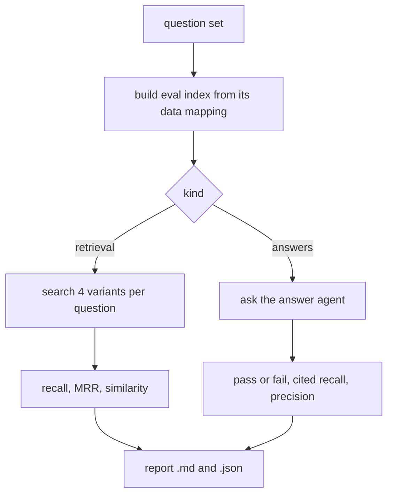

# `backend/app/evaluation.py`

> Measures quality: does search find the lessons a person labelled as right, and does the chatbot cite them in its answer?

**Part of:** Evaluation  ·  **Layer:** Tooling

## Purpose
Without numbers, every change (a new model, a new flag, a new weight) is a guess. This file runs a fixed question set on a fixed copy of the made-up data and writes a report. Bring your own question set and its data mapping (`EVAL_QUESTIONS`, `EVAL_DATASET`). Example: question q01 "I am starting commissioning on Valoria Metro Line 5..." should surface lessons 1020, 1013, 1016, 1028 and 1003; the eval tells you how many of them were found and how high.

## How it works
1. **Own data, own folder.** `eval_settings` makes a copy of the settings that uses the mapping in `EVAL_DATASET`, a fresh folder `DATA_DIR/eval/runs/<time>-<process id>`, local storage, file feedback, no answer cache and in-process retrieval and graph agents. So uploads, the dev index and S3 are never touched, and two eval runs at once do not mix.
2. **Build the eval index** (`build_eval_index`): load the eval data set and build an in-memory index with the configured embedding model. Embeddings are cached in `DATA_DIR/eval`, so a second run does not embed again.
3. **Retrieval eval** (`run_retrieval`): for every question with a `search` block, run the search four ways (variants) and score the top hits:
   - `keyword`: word search only.
   - `vector`: meaning search only.
   - `hybrid`: both, merged.
   - `hybrid+context`: both, plus the question's ideal `context` and `related_to` (for example the project).
   With `--store neo4j` the eval graph is built in Neo4j first, and the dev graph is rebuilt afterwards (Neo4j Community has only one database).
4. **Answer eval** (`run_answers`): ask the real answer agent each question (the model chooses its own tools) and check what it cited.
5. **Report** (`save_report`): JSON and Markdown in `DATA_DIR/eval/reports/<kind>-<time>.{json,md}`.



## Key components
- `VARIANTS`: the four search variants and which flags each switches off.
- `recall_at(ranked, expected, k)`: share of expected lessons in the top k, capped: divided by `min(k, number expected)`. So a question with 8 right lessons can still reach 1.0 at k = 5.
- `reciprocal_rank(ranked, expected)`: 1 / position of the first right lesson ([MRR](../../../glossary.md) when averaged). First place = 1.0, third place = 0.33, none = 0.
- `run_retrieval(settings, stores=("memory",), k=5, questions=None)`: out: `{kind, k, embedding, rows, summary}`.
- `score_search(...)`: one row: top ids, top similarity, recall, MRR, and the expected lessons that were missed.
- `summarize_retrieval(rows)`: per store/variant: average recall@k and MRR (`None` when the group has no labelled questions; the CLI then prints "no labelled questions"), plus the lowest top similarity of answerable questions and the highest of no-answer questions. If those two overlap, similarity alone cannot tell "nothing relevant" from a real hit.
- `run_answers(settings, store="memory", ids=None, limit=None, questions=None, llm=None)`: out: `{kind, store, llm, features, embedding, rows, summary}`. Tests pass a fake `llm`.
- `score_answer(agent, q)`: pass rules:
  - with `expected`: at least half of `min(5, expected)` cited (`recall >= 0.5`);
  - `expect: clarify`: the bot asked a clarifying question;
  - `expect: none`: nothing cited, or the lessons are marked "related only";
  - a crash is always a fail.
- `summarize_answers(rows)`: passed count, cited recall and precision, average seconds, grounding issues removed by the checks, errors, pass count per question type.
- `save_report(result, data_dir)`, `to_markdown(result)`: write the report; returns the `.md` path.

## Configuration
- `EVAL_QUESTIONS` (default none): path to the question set (YAML). `EVAL_DATASET` (default none): the dataset mapping the questions were written for. Both must be set to run `app.cli eval`.
The eval uses your normal settings for the models (`LLM_PROVIDER`, `LLM_MODEL_ID`, `EMBEDDING_*`, `FEATURE_EVIDENCE_GRADING`, `GRADER_*`, `FEATURE_CLARIFYING_QUESTIONS`, `FEATURE_GROUNDING_CHECKS`, ...). It overrides these for its own run:
- `DATA_DIR` -> `DATA_DIR/eval/runs/<run id>`
- `DATASET_CONFIG` -> the mapping in `EVAL_DATASET`
- `AGENT_RETRIEVAL_URL`, `AGENT_GRAPH_URL` -> empty (a remote service would not have the eval index)
- `STORAGE` -> `local`, `FEEDBACK_STORE` -> `file`, `FEATURE_ANSWER_CACHE` -> `false`
- per variant: `FEATURE_VECTOR_SEARCH`, `FEATURE_KEYWORD_SEARCH`, `FEATURE_CONTEXT_BOOST`
- `--store neo4j`: `SEARCH_STORE=neo4j`, `FEATURE_NEO4J=true` (needs `NEO4J_URI` etc.)

## Dependencies
- **Used by:** [cli.py](cli.md) (`eval retrieval`, `eval answers`).
- **Uses:** [agents/__init__.py](agents/__init__.md) (embedding, retrieval, graph clients, answer agent), [dataset.py](dataset.md) (`load_all`, `load_mapping`), [search/memory.py](search/memory.md) (`build_index`), [settings.py](settings.md); reads the question set and its data mapping (`EVAL_QUESTIONS`, `EVAL_DATASET`).

## Example
```bash
cd backend
.venv/bin/python -m app.cli eval retrieval --store memory
```
prints one line per variant, for example:
```
memory/hybrid+context    recall@5=0.981  mrr=...  sim: lowest answerable=...  highest no-answer=...
```
(0.981 is the latest recall@5 for memory / hybrid+context with bge-m3; Neo4j gives 0.948.)

Latest answer eval recorded (Nova 2 Lite + grader): 24/25 passed in one run (q02 borderline: the grader dropped two lessons; 3/3 PASS on re-runs), cited recall 0.904, precision 0.944, 3.0 s per answer.

Answer eval row for q12 "Our trains overheat when they run through long tunnels." (expected `["1016"]`): if the answer cites 1016, recall = 1/1 = 1.0 and the row is PASS.

## Known limitations and improvements
- 25 questions on 29 usable made-up lessons (32 rows, 3 skipped), labelled by one person; good for catching regressions, not proof of quality on production data. Idea: a production question set labelled by experts, run in CI as a gate.
- A question with neither `expected` nor `expect: clarify|none` simply fails (`passed` starts as false).
- A store/variant group without labelled questions has `None` for recall and MRR; the CLI prints "no labelled questions" and the report treats it as 0 when picking the best variant.
- With `--store neo4j` the eval replaces the dev graph and rebuilds it at the end; if that rebuild fails, the dev graph is left with eval data.
- The pass rule for answers is "half of the expected lessons cited"; it does not judge the wording. Idea: an LLM judge (listed as planned in `.env.example`).
