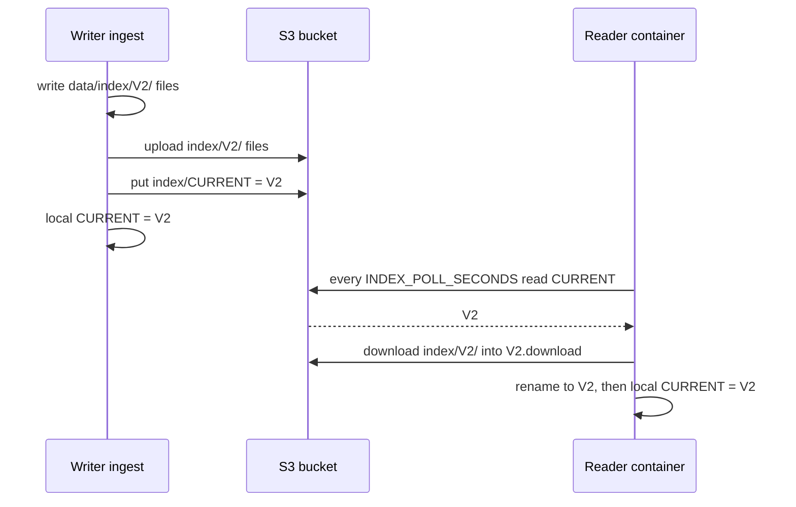

# `backend/app/index_files.py`

> Manages index versions on disk (`data/index/<version>/` plus a `CURRENT` pointer) and, with `STORAGE=s3`, mirrors them to S3 so several containers share one index.

**Part of:** [Storage and versions](../../../flows/storage-and-versions.md) · [Load data](../../../flows/load-data.md) · [Deployment](../../../flows/deployment.md) · [Feedback](../../../flows/feedback.md)  ·  **Layer:** Storage

## Purpose
After an admin uploads a new file, every running copy of the app must switch to the new data at the same time, and never read a half-written index. On AWS Fargate the containers' disks do not survive a restart, so the index must live in S3 too. This file does both with one simple rule: **write the new version folder first, move the pointer last**. Readers only follow the pointer. An *index version* and the *pointer* are explained in the [glossary](../../../glossary.md).

## How it works

Locally (`STORAGE=local`) only the left side happens: files in a folder, then `CURRENT` written to a temp file and renamed, so a reader never sees half a pointer.

With S3:
1. `publish(version)` uploads every file of the version, then writes the S3 pointer, then the local one.
2. `current_version()` calls `_sync()`, which checks the S3 pointer at most every `INDEX_POLL_SECONDS`. If it names a version whose folder has no `meta.json` yet, it first removes anything left over from an earlier, interrupted download (a `<version>.download` folder or an incomplete `<version>` folder), downloads the files to `<version>.download`, renames that folder to `<version>`, and moves the local pointer.
3. `meta.json`, `lessons.jsonl` and `vectors.npy` must download; `context_items.jsonl` and `mapping.json` are optional (older versions may lack them).

## Key components
- `INDEX_FILES`: `meta.json`, `lessons.jsonl`, `context_items.jsonl`, `vectors.npy`, `mapping.json`.
- `S3Remote(client, bucket, prefix, poll_seconds=30)`: thin S3 wrapper: `put_file`, `put_bytes`, `get_file`, `list_keys` (paged, with `StartAfter` so only new keys are listed), `get_bytes_by_key`, `pointer()`. Also used by the feedback store.
- `IndexStore(data_dir, remote=None)`:
  - `current_version()`: the live version name or `None`.
  - `new_version_dir(version)`: creates the folder (fails if it exists).
  - `publish(version)`: makes it live.
  - `current_folder()`: path of the live version; raises "no index ... run ingest first" if none.
  - `read_current()`: meta, lesson dicts, item dicts, vectors and mapping of the live version.
  - `current_mapping()`, `current_meta()`: just those parts, or `None`.
- `read_jsonl(path)`: one JSON object per line.
- `store_for(settings)`: the right `IndexStore`. One `S3Remote` per bucket/prefix is shared, so all callers share the poll timer.
- `s3_client(settings)`: boto3 S3 client; access keys only for a local S3 stand-in (moto); on AWS the task role is used.
- `as_store(target)`: accepts an `IndexStore` or a plain folder.

## Configuration
| Setting | Default | Effect |
|---|---|---|
| `STORAGE` | local | `s3` turns on the S3 mirror (needs `S3_BUCKET`) |
| `DATA_DIR` | `backend/data` | Local working copy at `<DATA_DIR>/index` |
| `S3_BUCKET`, `S3_PREFIX` | none, lessons | Where versions go: `s3://<bucket>/<prefix>/index/<version>/...` |
| `S3_REGION`, `S3_AWS_PROFILE` | us-east-1, none | boto3 session |
| `S3_ENDPOINT_URL`, `S3_ACCESS_KEY`, `S3_SECRET_KEY` | none | Only for S3 stand-ins |
| `INDEX_POLL_SECONDS` | 30 | How often a container checks the S3 pointer |

## Dependencies
- **Used by:** [search/memory.py](search/memory.md) (`as_store`, `build_index` publishes), [agents/retrieval.py](agents/retrieval.md), [agents/graph.py](agents/graph.md), [agents/ingest.py](agents/ingest.md), [api.py](api.md) (current meta / mapping), [feedback.py](feedback.md) (shares the `S3Remote`).
- **Uses:** boto3 (only with S3), numpy.

## Example
Local disk after two ingests:
```
backend/data/index/
  20261118-090000-1a2b/  meta.json lessons.jsonl context_items.jsonl vectors.npy mapping.json
  20261118-101500-a1b2/  ...
  CURRENT                -> contains "20261118-101500-a1b2"
```
`IndexStore("backend/data").current_version()` returns `"20261118-101500-a1b2"`.

## Known limitations and improvements
- Old versions are never deleted, locally or in S3. Idea: keep the last N versions.
- If a required file fails to download, the error goes up to the caller and the local pointer stays on the old version. The half-filled `<version>.download` folder stays on disk until the next try, which removes it first. Because the poll time was already updated, that next try waits for the next poll interval.
- A reader may serve the old version for up to `INDEX_POLL_SECONDS` after a publish elsewhere. That is by design.
