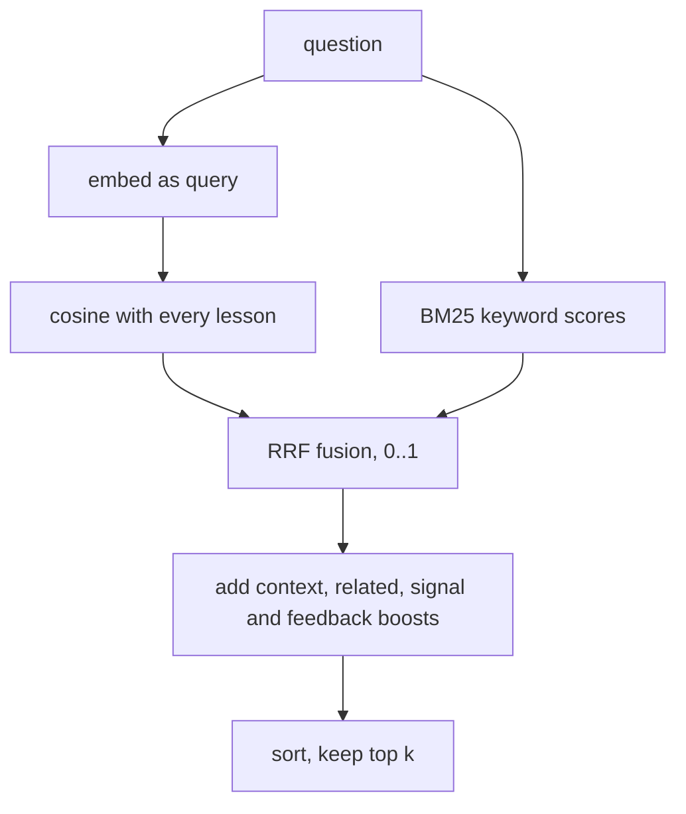

# `backend/app/search/memory.py`

> The default search store: it builds index versions on disk and searches all lessons in memory with BM25 keyword search plus vector search, then adds small boosts and reasons.

**Part of:** [Ask a question](../../../../flows/ask-a-question.md) · [Load data](../../../../flows/load-data.md) · [Storage and versions](../../../../flows/storage-and-versions.md) · [Feedback](../../../../flows/feedback.md)  ·  **Layer:** Search & data

## Purpose
At hundreds to a few thousand short lessons, the fastest search is to keep everything in memory (about 0.1 s). This file has both halves:
- `build_index` writes a new *index version* (a folder with the lessons, context items, embeddings and mapping, see the [glossary](../../../../glossary.md)) and publishes it;
- `MemoryStore` loads the current version and ranks lessons for a question, with reasons the UI can show ("matches stage Commissioning", "comparable project: Valoria Metro Line 4").

## How it works

### Build
1. Refuse an empty lesson list (publishing it would break every search; the old index stays live).
2. Make a version name: date-time plus 4 random hex characters, for example `20261118-101500-a1b2`.
3. Embed each lesson's `embed_text()` (title, text, context) as a "document".
4. Write `vectors.npy`, `lessons.jsonl`, `context_items.jsonl`, `meta.json` (version, embedding model, counts) and `mapping.json`.
5. Publish: the store moves the `CURRENT` pointer (see [index_files.py](../index_files.md)).

### Search

For every lesson:

```
score = fused
      + SCORE_W_CONTEXT  x number of context matches
      + SCORE_W_RELATED  x related-item score (0..1)
      + ranking signals  (weighted, from the mapping)
      + SCORE_W_FEEDBACK x feedback score (-1..1)
```

- `fused`: the [RRF](fusion.md) result of the vector and keyword rankings, 0..1.
- context matches: how many of the requested `(dimension, value)` pairs the lesson really has ([context.py](../context.md)). Off when `FEATURE_CONTEXT_BOOST=false`.
- related-item score: 1.0 for the same item, otherwise how comparable the lesson's item is ([context_sources.py](../context_sources.md)).
- ranking signals: for example impact `0.05 x impact / 5` ([ranking.py](../ranking.md)).
- feedback score: from thumbs up/down on similar questions ([feedback.py](../feedback.md)).

Each hit keeps the parts (`vector`, `keyword`, `fused`, `context_matches`, `related`, `signals`, `feedback`) for the debug panel, and a list of reasons.

## Key components
- `tokenize(text, stopwords)`: lowercase words of 2+ characters, minus stopwords.
- `BM25(docs, stopwords, k1=1.5, b=0.75)`: a small BM25 keyword scorer (BM25 rewards rare words and many hits, and corrects for long texts). `scores(query)` returns one score per lesson.
- `Hit(lesson, score, reasons, parts)`: one search result.
- `build_index(lessons, items, embedder, target, mapping=None)`: writes and publishes a version, returns its name.
- `MemoryStore.load(target, embedder, settings, mapping)`: loads the current version. Fails if the index was built with a different embedding model than the embedder (vectors from two models cannot be compared). Uses the mapping saved with the index, or the configured one.
- `MemoryStore.search(query, context=None, related_to=None, k=None, feedback=None)`: list of `Hit`, best first, at most `k` (default `TOP_K_CANDIDATES`).

## Configuration
| Setting | Default | Effect |
|---|---|---|
| `SEARCH_STORE` | memory | This store is used when `memory` |
| `TOP_K_CANDIDATES` | 20 | Hits returned when `k` is not given |
| `FEATURE_VECTOR_SEARCH`, `FEATURE_KEYWORD_SEARCH` | true, true | Which rankings are fused; with keyword off, BM25 is not run |
| `FEATURE_CONTEXT_BOOST` | true | Count context matches |
| `SCORE_W_CONTEXT` | 0.05 | Per context match |
| `SCORE_W_RELATED` | 0.15 | Times the related-item score |
| `SCORE_W_FEEDBACK` | 0.1 | Times the feedback score |
| `ASSISTANT_CONFIG` | `config/assistant.yaml` | Stopwords for BM25 |

## Dependencies
- **Used by:** [agents/retrieval.py](../agents/retrieval.md) (`MemoryStore`), [agents/ingest.py](../agents/ingest.md) and [evaluation.py](../evaluation.md) (`build_index`).
- **Uses:** [search/fusion.py](fusion.md), [index_files.py](../index_files.md), [context.py](../context.md), [context_sources.py](../context_sources.md), [ranking.py](../ranking.md), [feedback.py](../feedback.md) (`feedback_reason`), [dataset.py](../dataset.md), [assistant.py](../assistant.md) (stopwords).

## Example
Question "door software regression test" with context `{"stage": ["Commissioning"]}`, offline hash embedder, made-up data, default weights. Lesson 1003 "Door software change again not regression tested":

| Part | Value | Adds |
|---|---|---|
| fused (1st in the vector list, 2nd in the keyword list; ties with 1025 at 1.0) | 1.0 | 1.0 |
| context matches (stage Commissioning) | 1 x 0.05 | 0.05 |
| related items | none asked | 0 |
| impact signal | 0.05 x 5/5 | 0.05 |
| feedback | no votes | 0 |
| **score** | | **1.10** |

Without the context (it is a bonus, not a filter), 1003 scores `1.0 + 0.05 = 1.05`: the fused 1.0 plus the impact signal.

The top 4 from the same run (recomputed offline):

| Lesson | fused | context | impact | score |
|---|---|---|---|---|
| 1003 | 1.0 | +0.05 | +0.05 | 1.100 |
| 1025 Door software regression suite incomplete | 1.0 | 0 | +0.04 | 1.040 |
| 1002 Door obstruction detection too sensitive in winter | 0.939 | +0.05 | +0.04 | 1.029 |
| 1001 Door controller firmware updated without regression test | 0.976 | 0 | +0.05 | 1.026 |

Reasons on 1003: `("context_match", "stage", "Commissioning")`.

## Known limitations and improvements
- Every lesson is scored on every search, and the top `k` is always returned, even if the matches are weak. Confidence and the grader handle weak results later ([ask-a-question flow](../../../../flows/ask-a-question.md)).
- BM25 has no stemming: "tested" and "test" are different words; idea: stemming.
- The whole index sits in memory: fine at the expected size; idea: pgvector only above about 50k rows.
- The weights are fixed defaults; tune them with the retrieval eval (evaluation flow).
