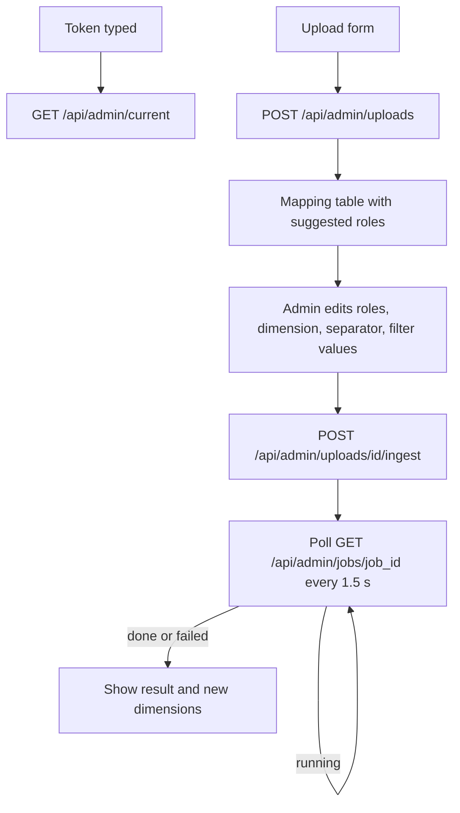

# `frontend/admin.js`

> The admin page logic: sends the file, shows the column profile with suggested roles, lets the admin change them, starts the index build and polls until it is done.

**Part of:** [Admin upload](../../flows/admin-upload.md) · [Load data](../../flows/load-data.md) · [Storage and versions](../../flows/storage-and-versions.md)  ·  **Layer:** UI

## Purpose
So a new extract can go live without code changes. The server guesses a role for each column (id, title, text, context, ranking, filter, ignore); the admin checks the guess and clicks "Build index". Building takes time (cleaning, embeddings, writing a new index version), so the page starts a background job and polls it.

## How it works

1. The token is kept in `sessionStorage` (`adminToken`) for this tab and sent as the `X-Admin-Token` header on every call.
2. `loadCurrent()` shows the live index: version, lessons, context items per source, embedding model, and dimension chips.
3. Upload: a `FormData` with `file`, optional `sheet`, `header_row`.
4. `renderMapping()` builds one table row per column with fill count (`filled/rows`), distinct count, top example values (all counts in the tooltip), a role dropdown, a dimension text box and a "Split by" dropdown (`—`, `;`, `|`, line break, `,`). Rows already known from the current mapping get a ✓.
5. Changing a role (`sync`): the dimension box shows for `context` and `ranking`; "Split by" shows only for `context`; if the dimension is empty it is made from the column name (e.g. "Status" -> `processing_status`); `ignore` rows are greyed out.
6. `renderFilters()`: for each column with role `filter`, a row of checkboxes "keep only ...". Values in `keep_status_values` (approved, closed, released, final) are ticked by default; earlier ticks are kept when the table is redrawn.
7. "Build index" POSTs `{roles, filters}` and gets a `job_id`, then polls every 1.5 seconds while `status === "running"`. After 30 minutes it gives up and shows "The ingest is taking very long. Check the server log." (the job itself may still finish on the server).
8. `renderResult(job)`: on `failed` shows the error. On `done` reloads the current index and shows "New index v… is live: X of Y rows loaded", the dimension chips with new ones highlighted, skipped rows with reasons (only when the result has a non-empty `skipped` list), lessons pointing to unknown context items, and the Neo4j rebuild counts or error.

## Key components
- `loadName()`: reads the app name from `GET /api/config` (no token needed) and shows "<name> · Admin" as the page title and header.
- `api(path, options)`: `fetch` with the token header; throws an `Error` with the server's `detail` when the status is not OK.
- `loadCurrent()`: fills "Current index" and remembers `knownDims`.
- `renderMapping()`: mapping table from `upload.profile` and `upload.suggestion`.
- `renderFilters()` / `currentFilters()`: filter checkboxes and their ticked values, `{column: [values]}`.
- `currentRoles()`: reads the table into `[{column, role, dimension, separator}]`; empty values become `null`.
- `renderResult(job)`: the result box.

## Configuration
Server side: `FEATURE_UPLOAD_UI`, `ADMIN_TOKEN`, `UPLOAD_MAX_MB`, `UPLOAD_MAX_ROWS` (see [`admin.html`](admin.html.md)). With `DATA_SOURCE=sparql` every admin call returns 409 "uploads are off while DATA_SOURCE=sparql", and the page shows that message (lessons then come from SPARQL source, so an uploaded file would be ignored). From [`assistant.yaml`](../backend/config/assistant.yaml.md): `keep_status_values` (default ticks) and `personal_column_hints` (columns the server suggests to ignore).

## Dependencies
- **Used by:** [`admin.html`](admin.html.md).
- **Uses:** [`backend/app/api.py`](../backend/app/api.md) routes `GET /api/admin/current`, `POST /api/admin/uploads`, `POST /api/admin/uploads/{id}/ingest`, `GET /api/admin/jobs/{id}`. Profiling and role suggestions come from [`backend/app/upload.py`](../backend/app/upload.md); the build runs in [`backend/app/agents/ingest.py`](../backend/app/agents/ingest.md).

## Example
Upload `overall_list_v2.csv`. "Status" is a `filter` column; "Approved" is ticked. Click "Build index". Request body:
```json
{"roles": [{"column": "ID", "role": "id", "dimension": null, "separator": null},
           {"column": "Supplier", "role": "context", "dimension": "supplier", "separator": null}, "..."],
 "filters": {"Status": ["Approved"]}}
```
Result: "New index … is live: 29 of 32 rows loaded." and a highlighted chip `supplier` under "New context dimensions: supplier".

## Known limitations and improvements
- The show/hide rules for the dimension and "Split by" boxes are written twice: once in `sync` and once right after each row is built. Small cleanup idea.
- Polling has no backoff (a fixed 1.5 s). If the server restarts, the job is gone (jobs are kept in memory) and polling fails with "unknown job".
- After giving up at 30 minutes the page cannot pick the job up again; the admin has to check the server log or reload and look at "Current index".
- The token sits in `sessionStorage`, readable by any script on the page. Acceptable for an internal admin page; idea: SSO for admins.
- The filter values list uses `values` from the profile or, if missing, only the top values, so rare status values may not appear as checkboxes.
