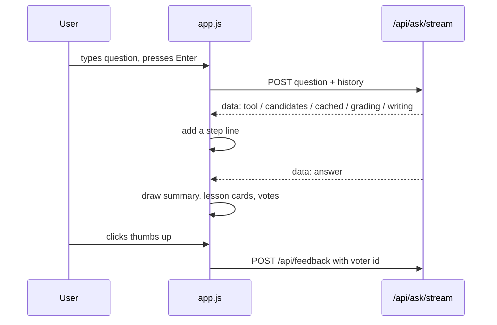

# `frontend/app.js`

> The chat page logic: sends the question, reads the live progress events from the server, draws the answer and lesson cards, and sends thumbs up/down votes.

**Part of:** [Ask a question](../../flows/ask-a-question.md) · [Feedback](../../flows/feedback.md)  ·  **Layer:** UI

## Purpose
An answer takes several seconds: the model searches, a grader may check the lessons, then the final answer is written. This file shows each step while it happens ("Searching lessons: door regression test", "Found: [1001] ...") so the user is not staring at a blank screen. Then it shows every cited lesson as a card with its ID, its confidence, why it is relevant, an exact quote and the original entry, so every answer can be checked against its source. Plain JavaScript, no framework and no build step.

## How it works

1. On load, `loadConfig()` calls `GET /api/config` and fills the header, placeholder and example buttons. An example button does nothing while a question is still running (one question at a time, like the form).
2. `ask(question)` adds the user bubble, a bot box with a step list and a "Thinking" spinner, and disables the Ask button.
3. It POSTs `{question, history}` to `/api/ask/stream`. The reply is SSE (server-sent events: a long HTTP reply where the server writes one small message at a time, see the [glossary](../../glossary.md)).
4. It reads the stream in chunks and cuts it at blank lines (`\n\n`). Blocks that start with `data: ` are parsed as JSON and passed to `handleEvent`. Other blocks, like the `: ping` heartbeat the server sends every 15 seconds, are skipped.
5. If the stream ends without an `answer` or `error` event, it shows "Something went wrong: the connection closed before the answer arrived".
6. After the answer it saves the question and a short memo of the answer in `history` so follow-up questions keep context.

### SSE event types handled by `handleEvent(event, ctx)`
- `tool`: a tool step. Adds a line like `Searching lessons: "door regression test"`. The label comes from `TOOL_LABELS` (`search_lessons`, `resolve_context`, `comparable_items`, `count_by`, `related_lessons`); the detail is the first of `input.query`, `term`, `name`, `dimension`, `id`.
- `candidates`: the first search hits, shown at once as `Found: [1001] Door controller ... · [1003] ...`. The final checked answer may show fewer.
- `cached`: "Same question answered recently: showing that answer".
- `grading`: "Checking which of N lessons really fit" (the grader agent is running).
- `writing`: changes the spinner text to "Writing the answer from N lessons". N (`lessons_found`) is the number of lessons the searches returned so far, before the grader and the checks; the answer may show fewer.
- `answer`: marks the request finished, removes the spinner and calls `renderAnswer`.
- `error`: marks finished, removes the spinner and shows the server message (for example "Too many questions at once. Please try again in a moment.").

Any other type is ignored.

### How a lesson card is built (`renderLesson`)
1. Copies `<template id="lesson-tpl">` from [`index.html`](index.html.md).
2. Fills the ID, title and `learning` text.
3. Confidence: shows `high`, `medium` or `low` and adds it as a CSS class (green, amber, red). If `lesson.fit === "partial"` it shows e.g. `low · partial fit`.
4. Reasons: one chip per item in `why_relevant`, worded by `REASON_LABELS`:
   - `context_match` -> `stage: Commissioning`
   - `same_item` -> `same project: Valoria Metro Line 4`
   - `comparable_item` -> `comparable project: Valoria Metro Line 4`
   - `similar_problem` -> `similar problem` (the full text is in the tooltip)
   - `feedback` -> `helpful for similar questions (3)`
   - unknown types show their `value`.
5. Quote: shown in curly quotes; hidden by CSS when empty.
6. "Original entry" (a fold-out): the full lesson `text` and a list of all context values (dimension: values).
7. "Related lessons" button: only shown when `config.graph` is true. It calls `GET /api/lessons/{id}/related` and lists `[id] title` with the first two "why" lines; all lines are in the tooltip. The button is disabled while loading. If the call fails, the box shows "Could not load related lessons. Please try again." and the button is enabled again.
8. Vote buttons: kept only when `config.feedback` is true, else removed.

### Vote buttons and `voterId`
- Each card has 👍/👎 for that lesson. Under the answer, `answerVotes` adds a second pair "Was this answer helpful?" for the whole answer (no `lesson_id`).
- `vote(button, payload)` POSTs to `/api/feedback`: `{answer_id, question, vote: "up"|"down", lesson_id?, voter}`. Only when the server answers with a success status does it mark the clicked button with the `chosen` class (and unmark the other one). If the request fails, the button is not marked and its tooltip says "Your vote could not be saved. Please try again."
- `voterId()` makes a random ID once per browser (random base-36 text plus the time) and keeps it in `localStorage` under `voterId`. The server counts only the latest vote of one voter, so clicking 👍 twenty times counts once. If `localStorage` is blocked, `voter` is `null`. When the platform sets an SSO user header (`USER_HEADER`), the server uses that instead.
- A 👎 on an answer also makes the server drop that answer from the answer cache, so the same question is answered fresh next time.

## Key components
- `loadConfig()`: reads `/api/config` into `config`; sets title, tagline, placeholder, example buttons; shows the debug toggle when `config.debug`.
- `ask(question)`: sends one question and reads the stream. Out: nothing; it draws into the page.
- `handleEvent(event, ctx)`: one SSE event -> one change on screen (see above).
- `renderAnswer(bot, result, question)`: draws, in order: clarifying question, summary, "related only" note (`related_only_text`), `next_step`, "Not covered by these lessons: ..." (`missing`), "No matching lessons were found" when `not_found` and no summary; then lesson cards, answer votes, and the debug block (`trace` and `issues` as JSON). Then updates `history` (each entry cut to 3900 characters, last 8 entries kept).
- `renderLesson(lesson, answerId, question)`: one card (see above).
- `showRelated(id, box, btn)`: graph neighbours of a lesson.
- `answerVotes`, `vote`, `voterId`: feedback (see above).
- `el(tag, cls, text)`: small helper to make an element. Text is always set with `textContent`, so lesson text from the data cannot inject HTML.
- Keys: Enter sends, Shift+Enter makes a new line. "New chat" reloads the page (clears history).

## Configuration
Read from `/api/config`, which comes from [`settings.py`](../backend/app/settings.md) and [`assistant.yaml`](../backend/config/assistant.yaml.md):
- `FEATURE_FEEDBACK` (default true) -> `config.feedback`: vote buttons on or off.
- `FEATURE_DEBUG_PANEL` (default false) -> `config.debug`: "details" toggle and the JSON debug block.
- `FEATURE_NEO4J=true` (a graph agent exists; `SEARCH_STORE=neo4j` also needs it) -> `config.graph`: "Related lessons" button.
- `assistant.yaml`: `app_name`, `tagline`, `placeholder`, `examples`, `related_only_text`.
- `FEATURE_EVIDENCE_GRADING` (default false): only then does the server send `grading` events.
- `FEATURE_ANSWER_CACHE` (default true): only then can a `cached` event arrive.
- `FEATURE_STREAMING` is sent as `config.streaming` but this file does not read it; it always uses `/api/ask/stream`.

## Dependencies
- **Used by:** [`index.html`](index.html.md).
- **Uses:** API routes in [`backend/app/api.py`](../backend/app/api.md): `GET /api/config`, `POST /api/ask/stream`, `GET /api/lessons/{id}/related`, `POST /api/feedback`. Events come from [`backend/app/agents/answer.py`](../backend/app/agents/answer.md). Styles in [`style.css`](style.css.md).

## Example
User clicks "Component: doors". Step lines appear:
```
› Searching lessons: "door system"
› Found: [1001] Door controller firmware updated without regression test · [1003] Door software change again not regression tested
› Checking which of 8 lessons really fit
› Writing the answer from 8 lessons …
```
(The step lines are illustrative: the exact search words and counts depend on the model. Not taken from a recorded run.)

Then a card: `1003` · "Door software change again not regression tested" · `HIGH`, chips `topic: Doors`, `comparable project: Valoria Metro Line 4`, and the quote. A 👍 click sends `{"answer_id":"…","question":"I am responsible for the door system…","vote":"up","lesson_id":"1003","voter":"k3j9…"}`.

## Known limitations and improvements
- A failed vote is only shown in the button's tooltip, which a user may not notice. Idea: a short visible message.
- After `showRelated` succeeds, the button stays disabled, so the related list cannot be refreshed without a new answer.
- After a failed vote the tooltip shows the error; the next successful vote restores the original "Useful" / "Not relevant" tooltip from [`index.html`](index.html.md).
- `voterId()` uses `Math.random`, fine for counting clicks but not an identity; anyone can send another voter ID. The code comment says SSO replaces it.
- `config.streaming` is ignored (see Settings). Idea: fall back to `POST /api/ask` when it is false.
- The step list stays above the answer after it finishes. Idea: fold it into a "steps" summary.
