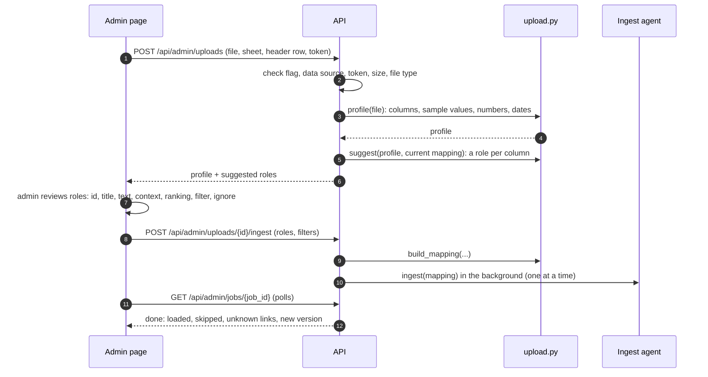

# Flow: admin upload

> How an admin loads a new spreadsheet from the browser, without editing config files. Back to the [overview](../README.md) · [glossary](../glossary.md)

**Files involved:** [frontend/admin.html](../files/frontend/admin.html.md) + [admin.js](../files/frontend/admin.js.md) →
[app/api.py](../files/backend/app/api.md) (`/api/admin/...`) → [app/upload.py](../files/backend/app/upload.md) →
[agents/ingest.py](../files/backend/app/agents/ingest.md) → the [load-data flow](load-data.md).

Needs `FEATURE_UPLOAD_UI=true` and an `ADMIN_TOKEN` in `backend/.env`, and file data: with `DATA_SOURCE=sparql`
the admin routes answer 409 "uploads are off while DATA_SOURCE=sparql" (ingest would read SPARQL source anyway). There is no login yet: on the target
platform, SSO will sit in front of the app.

## Step by step

1. **Upload.** The admin picks a CSV or Excel file (and the sheet and header row for Excel).
2. **Profile.** [upload.py](../files/backend/app/upload.md) looks at every column: how many distinct values, sample
   values, whether it is a number (and its max) or a date.
3. **Suggest roles.** Columns that already appear in the current mapping keep their role. Columns that look like
   personal data ("contact", "rated by", "email"… from [assistant.yaml](../files/backend/config/assistant.yaml.md)) are
   set to **ignore**. A column matching a context source key (e.g. project names) is linked to that source.
4. **Review.** The admin changes roles if needed, picks which status values to keep for a filter column, and
   starts the ingest.
5. **Ingest job.** Runs in the background; only one at a time (a second one gets "409: another ingest is still
   running"). The admin page polls the job and gives up with a message after 30 minutes. The new index version
   becomes live when done; new columns become new searchable **dimensions**
   right away.

With `STORAGE=s3` the raw file is also saved to S3, because a container's disk does not survive a restart.

## What could be better

- Upload context-source files (projects, suppliers) from the page too; today only the lessons file.
- Real login / roles once SSO is connected.
