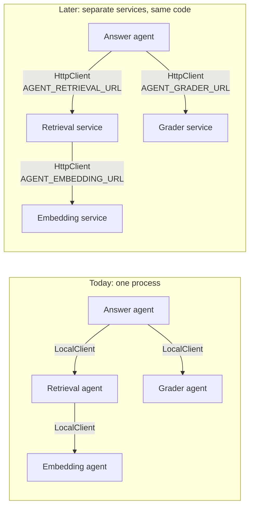

# Flow: how the agents are separated

> All parts run in one process today, but each can become its own service by setting one URL. Back to the
> [overview](../README.md) · [glossary](../glossary.md)

**Files involved:** [agents/\_\_init\_\_.py](../files/backend/app/agents/__init__.md) (the wiring),
[agents/transport.py](../files/backend/app/agents/transport.md), [agents/clients.py](../files/backend/app/agents/clients.md).

## The idea

Every agent is a small class with a `name` and a list of `methods`. Nobody calls those methods directly.
They go through a **client** with one function, `call(method, **arguments)`:

- **LocalClient**: calls the agent in the same process. It still converts arguments and results to JSON and back,
  so the code behaves exactly as if it went over the network.
- **HttpClient**: sends the same call as `POST /<method>` to another service.



## The wiring

[agents/\_\_init\_\_.py](../files/backend/app/agents/__init__.md) is the **only** place that decides how to reach an agent:

| Function | Returns | Switched off when |
|---|---|---|
| `embedding_client` | embedding agent | never |
| `retrieval_client` | retrieval agent, or the graph agent if `SEARCH_STORE=neo4j` | never |
| `graph_client` | graph agent | `FEATURE_NEO4J=false` |
| `grader_client` | grader agent | `FEATURE_EVIDENCE_GRADING=false` |
| `sparql_client` | SPARQL source agent | `DATA_SOURCE` is not `sparql` |
| `make_ingest_agent`, `make_answer_agent` | the two "orchestrating" agents | n/a |

Each one uses `HttpClient` when its URL setting is set (`AGENT_EMBEDDING_URL`, `AGENT_RETRIEVAL_URL`,
`AGENT_GRAPH_URL`, `AGENT_SPARQL_URL`, `AGENT_GRADER_URL`), otherwise `LocalClient`.

## Running one agent as its own service

```bash
python -m app.cli serve retrieval --port 8101      # in one terminal (or container)
AGENT_RETRIEVAL_URL=http://localhost:8101 uvicorn app.api:create_app --factory   # the app uses it over HTTP
```

Servable agents: `embedding`, `retrieval`, `graph`, `sparql`, `grader`.

## The rule that keeps it clean

Code outside `app/agents/` may only use the wiring functions, never import an agent module directly.
That keeps every agent replaceable by a separate service without touching the rest of the code.

## What could be better

- The HTTP transport has no authentication; when agents run as separate services they must be on a private
  network (or get a token).
- Ideas: expose the retrieval tools as an **MCP server** so other AI agents can use them ([improvements](../improvements.md)).
