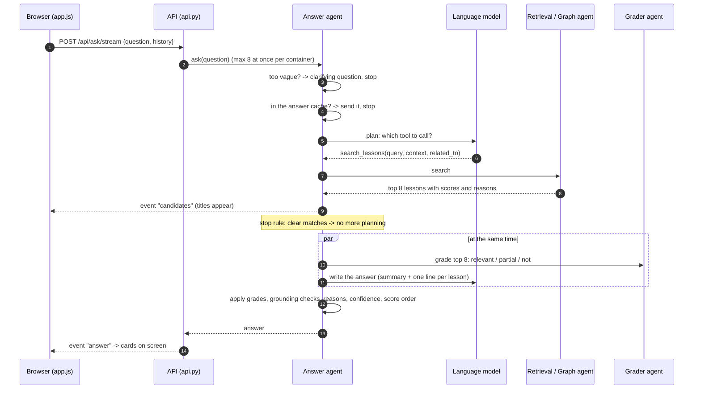

# Flow: asking a question

> What happens between pressing **Send** and seeing the lesson cards. Back to the [overview](../README.md) · [glossary](../glossary.md)

**Files involved:** [frontend/app.js](../files/frontend/app.js.md) → [app/api.py](../files/backend/app/api.md) →
[agents/answer.py](../files/backend/app/agents/answer.md) → [agents/retrieval.py](../files/backend/app/agents/retrieval.md)
or [agents/graph.py](../files/backend/app/agents/graph.md) → [search/memory.py](../files/backend/app/search/memory.md) →
[agents/grader.py](../files/backend/app/agents/grader.md) → [llm.py](../files/backend/app/llm.md) → back to the browser.

## The whole flow in one picture

## Step by step

**1. The browser sends the question.** [app.js](../files/frontend/app.js.md) posts to `/api/ask/stream` and listens to
live events (SSE). The user sees progress lines such as "Searching…", "Checking which of 8 lessons really fit…".

**2. The API takes a slot.** [api.py](../files/backend/app/api.md) runs at most `MAX_CONCURRENT_ANSWERS` (8) answers at
once per container. More questions wait up to `BUSY_WAIT_SECONDS`, then get "Too many questions at once".

**3. Too vague?** If the first question has only filler words ("help me with lessons"), the
[answer agent](../files/backend/app/agents/answer.md) returns the clarifying question from
[assistant.yaml](../files/backend/config/assistant.yaml.md) at once. No model call.

**4. Cached?** If the same question (ignoring case and punctuation) was answered on the same data and settings
in the last 15 minutes, the stored answer comes back in ~0 s ([cache.py](../files/backend/app/cache.md)).

**5. Plan and search.** The language model gets the question and a list of **tools**:

| Tool | Does |
|---|---|
| `search_lessons(query, context, related_to)` | hybrid search; `context` like `{"stage": ["Commissioning"]}`, `related_to` like `{"project": "Valoria Metro Line 5"}` |
| `resolve_context(term)` | maps a loose word to a known value ("comissioning" → stage = Commissioning) |
| `comparable_items(source, name)` | similar projects / suppliers with scores |
| `count_by(dimension)` | how often each value occurs, for "what keeps recurring?" |
| `related_lessons(id)` | lessons connected in the graph (only with Neo4j on) |

Normally the model calls `search_lessons` once. The search itself already maps loose context words to the data's
values ([context.py](../files/backend/app/context.md)) and boosts lessons of the named or comparable projects
([context_sources.py](../files/backend/app/context_sources.md)). The candidate titles are streamed to the browser
immediately. If the search signal is clear, the **stop rule** skips further planning. The model gets at most
`LLM_MAX_TOOL_ROUNDS` (default 2) rounds of tool calls; then the final answer is written. If the model doesn't search
at all, the code searches anyway, so the answer is always based on data.

A context word is only mapped when it fits one value clearly. If it fits several (project "line" fits
"Valoria Metro Line 4" and "Valoria Metro Line 5"), the search keeps it as typed and returns it in
`context_unresolved` with the candidates, so the model can ask or pick.

**6. Grade and write at the same time.** With `FEATURE_EVIDENCE_GRADING=true` the
[grader](../files/backend/app/agents/grader.md) checks the top 8 (`GRADER_MAX_CANDIDATES`) while the model writes:

- **relevant** lessons are kept; **partial** ones only to fill up to 3;
- only partial → shown as **"related, might still help"**;
- nothing fits → an honest **"no matching lesson"** with what is missing and a suggested next step.
- the search found nothing → the grader is not called at all; the answer simply says nothing was found.

**7. Checks in code.** Whatever the model wrote, the code:

- drops lessons the search did not return, and lessons graded "not";
- removes quotes that are not literally in the lesson text;
- builds the "why relevant" reasons from the search (context match, same / comparable project, similar problem);
- if the model cited only removed lessons, builds the cards from the lessons the grader kept;
- sets **confidence** (high / medium / low) from the search signals and the grade;
- sorts the cards by **search score** (`FEATURE_SCORE_ORDER`).

If the final model call fails (timeout, reply cut off, broken JSON), the question does not fail: the cards are
built from the checked lessons (the grader's picks, or the top 3 hits), with a fixed summary, and the answer is
marked **degraded**. A degraded answer (also: grader gave no usable verdict, or a tool returned an error) is shown
but never cached.

**8. On screen.** Each card shows the title, the learning, the reasons, a quote, the confidence, the original
entry (with all its context columns) and 👍/👎 buttons ([flows/feedback.md](feedback.md)).

## Timing (measured, Nova 2 Lite + grader, 25 test questions)

- new question: **about 3.0 s** on average in the latest answer eval (plan ~1 s, search 0.05 s, write + grade in parallel ~1.5–2 s; the split per step is from earlier bench runs)
- repeated question: **~0 s** (cache)
- vague question: **~0 s** (decided in code)

## Switches that change this flow

`FEATURE_EVIDENCE_GRADING`, `FEATURE_PARALLEL_GRADING`, `FEATURE_STOP_RULE`, `FEATURE_ANSWER_CACHE`,
`FEATURE_CLARIFYING_QUESTIONS`, `FEATURE_GROUNDING_CHECKS`, `FEATURE_REASONS_IN_CODE`, `FEATURE_SCORE_ORDER`,
`FEATURE_FEEDBACK_BOOST`, `SEARCH_STORE`, `TOP_K_ANSWER`, `LLM_MAX_TOOL_ROUNDS`. All on the [settings page](../files/backend/app/settings.md).

## What could be better

- A **fast path**: search first in code, then one short model call, aiming at ~1.5–2.5 s ([improvements](../improvements.md)).
- The planning call almost always just says "search", so it is the first thing to remove.
