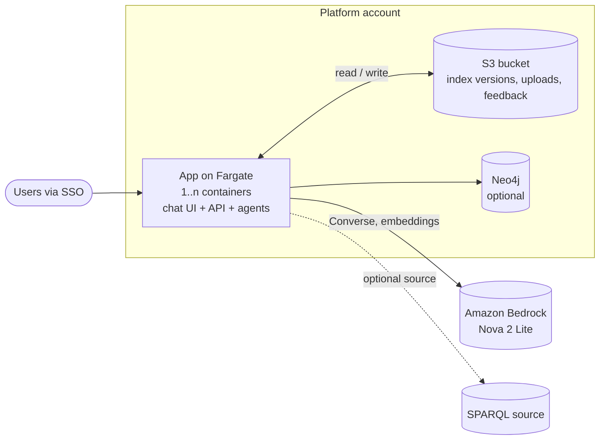

# Flow: deployment

> How the app is packaged and how it is meant to run on the target platform (AWS). Back to the
> [overview](../README.md) · [glossary](../glossary.md)

**Files involved:** [Dockerfile](../files/Dockerfile.md), [docker-compose.yml](../files/backend/docker-compose.yml.md),
[.env.example](../files/backend/env.example.md), [index_files.py](../files/backend/app/index_files.md) (S3),
[llm.py](../files/backend/app/llm.md) (Bedrock).

## Target picture



- **One Docker image** holds the backend and the frontend; the health check is `GET /api/health`.
- **No keys in the image.** On AWS the container uses its task role; for a local container test, credentials come from the shell environment.
- **S3 holds the state** (`STORAGE=s3`, `FEEDBACK_STORE=s3`), so any number of containers can run and restart.
- **Bedrock in another account** is reached with `BEDROCK_ROLE_ARN` (the task role assumes a Bedrock-only role).
- **Load protection**: at most 8 answers at once per container, Bedrock retries with backoff, timeouts.

## Status

| Step | Status |
|---|---|
| Docker image builds and runs locally | done |
| Container loads the index from S3 (local stand-in), answers, writes feedback, follows new versions | done (about 6 s to switch) |
| Container calls Bedrock (Nova 2 Lite) | done |
| Test run on real AWS Fargate (a separate test account) | not done yet |
| Platform specifics (CI pipeline, port, network to Neo4j) | depend on the target environment |


## Local containers

```bash
cd backend
docker compose --env-file .env up -d neo4j                            # graph database, browser at http://localhost:7474
docker compose --env-file .env --profile sparql-sim up -d fuseki  # Fuseki: a local stand-in for SPARQL source
docker compose --env-file .env --profile app up -d --build app        # the app container (S3 stand-in: moto_server -p 9000 first)
```
