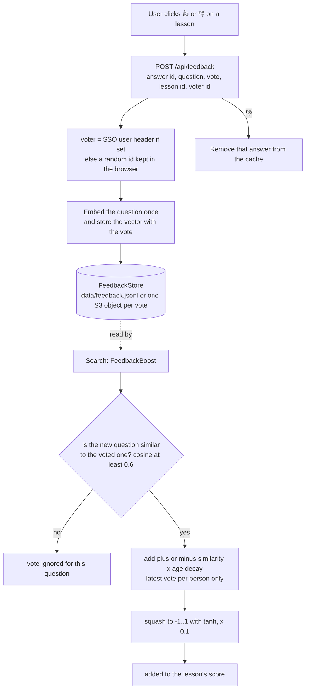

# Flow: feedback (👍 / 👎)

> What a vote does: it is stored, a disliked cached answer is dropped, and helpful lessons move up for similar
> questions. Back to the [overview](../README.md) · [glossary](../glossary.md)

**Files involved:** [frontend/app.js](../files/frontend/app.js.md) → [app/api.py](../files/backend/app/api.md) `/api/feedback` →
[app/feedback.py](../files/backend/app/feedback.md) → [app/cache.py](../files/backend/app/cache.md) →
read back by [search/memory.py](../files/backend/app/search/memory.md) and [agents/graph.py](../files/backend/app/agents/graph.md).

## The rules, in plain words

- A vote **only counts for questions like the one it was given for**. A 👍 on lesson 1013 for
  "faults after software updates" does nothing for "HVAC condensate leaking".
- **One vote per person** per lesson and question: clicking 20 times counts once; the latest vote wins.
- Votes **fade** with age: half the weight after 180 days (`FEEDBACK_HALF_LIFE_DAYS`).
- The effect is **capped**: at most ±0.1 on the score (`SCORE_W_FEEDBACK`), so votes nudge, never take over.
- A 👎 **never removes** a lesson; it only ranks it lower.
- Votes **are not evidence**: they don't raise confidence or make the search look "clear".
- A lesson with more 👍 than 👎 shows the reason "helpful for similar questions (3 up, 0 down)".

**Seen in a live check:** after 3 upvotes, lesson 1013 ranked 2nd for the voted question in both the memory and the
Neo4j search, with the reason "feedback 3 up", while an unrelated question's ranking stayed the same.

## Where votes are stored

- `FEEDBACK_STORE=file`: one JSON line per vote in `backend/data/feedback.jsonl` (re-read when the file changes).
- `FEEDBACK_STORE=s3`: one small S3 object per vote (S3 cannot append); new ones are loaded in the background,
  so a search never waits for S3. Another container sees a vote after up to `INDEX_POLL_SECONDS` (30 s).

## Switches

`FEATURE_FEEDBACK`, `FEATURE_FEEDBACK_BOOST`, `SCORE_W_FEEDBACK`, `FEEDBACK_MIN_SIMILARITY`, `FEEDBACK_HALF_LIFE_DAYS`,
`FEEDBACK_STORE`, `USER_HEADER`.

## What could be better

- With the real SSO user id, votes become truly one-per-person (today: one per browser).
- For many votes and many containers, a database (DynamoDB or Aurora) instead of S3 objects.
- A cached answer does not see new votes until it expires (up to 15 minutes).
