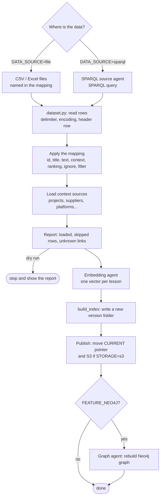

# Flow: loading data (ingest)

> How a spreadsheet becomes something the chatbot can search. Back to the [overview](../README.md) · [glossary](../glossary.md)

**Files involved:** [cli.py](../files/backend/app/cli.md) (or the [admin upload](admin-upload.md)) →
[agents/ingest.py](../files/backend/app/agents/ingest.md) → [dataset.py](../files/backend/app/dataset.md) with the mapping
[config/dataset.yaml](../files/backend/config/dataset.yaml.md) → [ranking.py](../files/backend/app/ranking.md) →
[agents/embedding.py](../files/backend/app/agents/embedding.md) → [search/memory.py](../files/backend/app/search/memory.md) `build_index` →
[index_files.py](../files/backend/app/index_files.md) → [agents/graph.py](../files/backend/app/agents/graph.md) (optional).

## The flow in one picture



## Step by step

**1. Start.** From the command line `python -m app.cli ingest` (add `--dry-run` to only check), or from the
[admin page](admin-upload.md) after an upload.

**2. Read the rows.** [dataset.py](../files/backend/app/dataset.md) reads CSV (it detects `,` / `;` / tab and
UTF-8 or Windows encoding) or Excel (sheet and header row from the mapping). With SPARQL source the rows come from a
SPARQL query instead ([sparql_source.py](../files/backend/app/agents/sparql_source.md)); a table without a query, or an
endpoint that cannot be reached, stops the ingest with a clear error instead of loading 0 rows.

**3. Apply the mapping.** The [mapping](../files/backend/config/dataset.yaml.md) says, for each column:

- `id`, `title`, `text`: the lesson itself (title is optional; a short title is made from the text if missing);
- `context`: columns that describe the situation (stage, topic, department…);
- `ranking`: number or date columns that make a lesson more important (impact, rating, created);
- `filter`: e.g. keep only `Status = Approved`;
- `ignore`: columns never used (e.g. personal names).

Rows are **skipped** and listed in the report with a reason, checked in this order: no id ("missing id"), not allowed
by a filter ("filtered out by Status"), a duplicate id, no text ("empty lesson text").

**4. Context sources.** Each configured source (e.g. `projects.csv`) is loaded as **context items** with their
attributes. Lesson values that don't match any item (a typo in a project name) are reported as **unknown links**.

**5. Embeddings.** Each lesson's text (title + text + context) is turned into a vector by the
[embedding agent](../files/backend/app/agents/embedding.md). Vectors are cached on disk, so re-loading unchanged
lessons is fast.

**6. Build and publish a version.** [build_index](../files/backend/app/search/memory.md) writes a new folder
`data/index/<version>/` with `lessons.jsonl`, `vectors.npy`, `context_items.jsonl`, `mapping.json`, `meta.json`.
Only when everything is written does the `CURRENT` pointer move ([storage and versions](storage-and-versions.md)).
Running answers keep using the old version until then. An empty result is refused.

**7. Neo4j (optional).** With `FEATURE_NEO4J=true` the [graph agent](../files/backend/app/agents/graph.md) rebuilds the
graph from the new version in one transaction. If that fails, the new index is still live and the old graph stays.

## Example output

`python -m app.cli ingest --dry-run` with `config/dataset.yaml` on the made-up data (checked by loading the file):

```
source: file  rows: 30, loaded: 27, skipped: 3
  skipped 1026: filtered out by Status
  skipped 1027: empty lesson text
  skipped 1030: filtered out by Status
```

Without `--dry-run` a line `index <version>: 27 lessons; 10 project` follows, and with `FEATURE_NEO4J=true` a
`graph: {...}` line with the graph counts.

## What could be better

- **Lesson cards at load time**: let a strong model write a one-line learning and tags per lesson once
  (future plan; [improvements](../improvements.md)).
- A data-quality report (empty fields, duplicate lessons, spelling variants of the same value).
