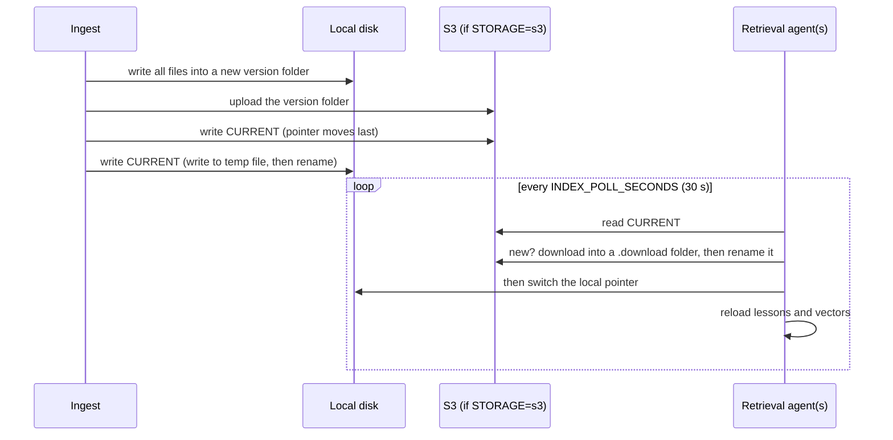

# Flow: storage and index versions

> How the searchable data is saved so that a new upload never breaks running answers, and how several containers
> share it. Back to the [overview](../README.md) · [glossary](../glossary.md)

**Files involved:** [index_files.py](../files/backend/app/index_files.md), [search/memory.py](../files/backend/app/search/memory.md)
(`build_index`, `load`), [agents/retrieval.py](../files/backend/app/agents/retrieval.md) (follows the version),
[feedback.py](../files/backend/app/feedback.md) (votes in the same bucket).

## On disk

```
backend/data/
  index/
    CURRENT                         <- one line: the live version, e.g. 20261118-030617-6349
    20261118-024717-8150/           <- an older version (kept)
    20261118-030617-6349/
      meta.json                     <- version, counts, embedding model
      lessons.jsonl                 <- one lesson per line: id, title, text, context, signals
      vectors.npy                   <- one embedding per lesson
      context_items.jsonl           <- projects, suppliers, ... with attributes
      mapping.json                  <- the mapping used to build it
  cache/                            <- cached embeddings (so unchanged lessons are not embedded again)
  feedback.jsonl                    <- votes (FEEDBACK_STORE=file)
  uploads/                          <- files uploaded on the admin page
```

## Publishing a new version safely



The key idea: **the pointer moves last**. A reader either sees the old version or the complete new one, never a
half-written one. Version names are a timestamp plus 4 random hex characters (e.g. `20261118-030617-6349`), so two
ingests in the same second don't collide. If a download was interrupted, the leftover `<version>.download` or
incomplete version folder is removed before the next try. The embedding cache file is also written to a temp file
and then renamed.

## Why S3

On AWS Fargate a container's disk is empty after every restart, and there may be several containers.
With `STORAGE=s3` each container downloads the live version at start and follows the pointer. Tested locally with
a stand-in for S3 (moto): an empty container loaded the index from "S3", answered, and switched to a new version in
about 6 s.

## Switches

`STORAGE`, `S3_BUCKET`, `S3_PREFIX`, `S3_REGION`, `S3_ENDPOINT_URL` (for a local stand-in), `INDEX_POLL_SECONDS`,
`DATA_DIR`.

## What could be better

- Old versions are kept forever; a clean-up of all but the last few would save space.
